# Prodigi Manufacturing Platform — Product Presentation Master

> **Document type:** Master presentation blueprint  
> **Version:** 1.1  
> **Last updated:** 4 August 2026  
> **Audience:** Internal teams, clients, sales, investors, trainers, product documentation  
> **Purpose:** Single source of truth for all Prodigi presentations — not slide decks themselves, but the complete content and structure from which any deck can be built.

---

## Document Control

| Field | Value |
|-------|-------|
| Product name | **Prodigi** (Manufacturing Execution System for garment factories) |
| Platform owner | RBC (Rajesh Bheda Consulting) |
| Deployment model | Multi-tenant SaaS — one Supabase project, factory-scoped data via RLS |
| Applications | Onboarding App · Prodigi Web (desktop admin) · Prodigi Floor (mobile PWA) |

---

## Table of Contents

1. [Executive Summary](#1-executive-summary)
2. [Vision](#2-vision)
3. [Product Overview](#3-product-overview)
4. [Platform Architecture](#4-platform-architecture)
5. [User Hierarchy](#5-user-hierarchy)
6. [Factory Lifecycle](#6-factory-lifecycle)
7. [Department Classification & Capture Architecture](#7-department-classification--capture-architecture)
8. [Application Overview](#8-application-overview)
9. [Detailed Workflow](#9-detailed-workflow)
10. [Data Captured](#10-data-captured)
11. [Reports](#11-reports)
12. [Dashboards](#12-dashboards)
13. [Configuration](#13-configuration)
14. [Security](#14-security)
15. [Technology](#15-technology)
16. [Product Design Principles](#16-product-design-principles)
17. [Benefits](#17-benefits)
18. [KPIs](#18-kpis)
19. [Future Roadmap](#19-future-roadmap)
20. [Presentation Version Guide](#20-presentation-version-guide)
21. [Slide Blueprint](#21-slide-blueprint)
22. [Visual Assets Checklist](#22-visual-assets-checklist)
23. [Demo Script](#23-demo-script)
24. [Appendix](#24-appendix)

---

# 1. Executive Summary

## What Prodigi Is

**Prodigi** is a **Manufacturing Execution System (MES)** built specifically for **garment factories**. It tracks every piece of production as it moves through departments — in-house or outsourced — from order creation through cutting, sewing, finishing, quality checks, packing, and shipment.

Prodigi is **not** an ERP, costing tool, or PLM. It does not manage BOM, fabric consumption, trim inventory, or payroll. Its single job:

> **Know what is planned, what is happening on the floor right now, and where every piece is in the flow.**

## Why It Was Built

Garment factories run on fragmented tools: spreadsheets for planning, paper challans for WIP movement, WhatsApp for escalations, and end-of-day Excel for reporting. Prodigi replaces this with:

- **Real-time floor capture** on tablets and phones
- **Mandatory handover transactions** between departments (WIP integrity)
- **Role-based apps** tuned to each person's job
- **Unified reporting** from the same data operators enter on the floor

## Problems It Solves

| Problem | Prodigi Solution |
|---------|------------------|
| No visibility into live WIP | Hourly/batch/QC capture + handover spine |
| Pieces "appear" in the next department without traceability | Mandatory handover challans with send/receive/dispute |
| Planning disconnected from floor reality | Line allocations linked to order routing and actuals |
| Quality data in separate systems | QC log integrated into the same order route |
| Management reports built manually overnight | Day Report, Style Report, Dashboard from live data |
| Outsourced departments treated as black holes | Two-leg handover (out-challan + return-challan) |
| Multiple capture modes conflicting | Output XOR QC rule — one active session per department+order |

## Target Customers

- **Mid-to-large garment export units** (500–5,000+ operators)
- **CMT / full-package manufacturers** with multi-department flows
- **Factories with outsourced processes** (printing, washing, embroidery)
- **Multi-buyer operations** needing per-style traceability
- **Consulting-led digital transformation** engagements (RBC deployment model)

## Industries

Primary: **Apparel / garment manufacturing**

Adjacent (future): footwear, home textiles, leather goods — any piece-flow factory with department handovers.

## Primary Users

| Persona | Application | Device |
|---------|-------------|--------|
| Platform operator (RBC) | Onboarding App | Desktop |
| Factory admin / plant manager | Prodigi Web | Desktop |
| Production planner | Prodigi Web | Desktop |
| Department supervisor | Prodigi Floor | Tablet / phone |
| Sewing / finishing operator | Prodigi Floor | Tablet / phone |
| QC inspector | Prodigi Floor | Tablet / phone |
| AQL auditor | Prodigi Floor | Tablet / phone |
| Shipment / terminal clerk | Prodigi Floor | Tablet / phone |

## Business Value

- **WIP accuracy:** Every piece movement is logged; disputes are visible, not hidden.
- **On-time delivery:** Cut-to-ship and OTIF metrics tracked per colorway against shipment plan.
- **Efficiency visibility:** Hourly output vs. target, SAM-based planning, workforce headcount correlation.
- **Quality at source:** DHU, defect Pareto, and QC pass rates per style/department/day.
- **Scalable onboarding:** New factories provisioned in minutes; no per-site custom code.
- **Lower reporting cost:** Management dashboards replace manual consolidation.

> **Speaker notes:** Open with a factory pain story — "Where are the 2,000 pieces between Cutting and Sewing?" Prodigi's answer is the handover transaction log, not a guess.

> **Presentation notes:** Use a single hero diagram: Order → Departments → Handover → Reports. Keep ERP/PLM explicitly out of scope on slide 2.

---

# 2. Vision

## Long-Term Vision

Prodigi becomes the **operating system for garment production** — the default layer every factory uses to run the floor, regardless of which ERP or buyer portal sits above it.

Long-term capabilities:

- Predictive delay alerts before shipment dates slip
- Buyer-facing portals with live WIP (read-only)
- Machine and IoT integration for automated count verification
- Cross-factory benchmarks for consulting engagements
- AI-assisted root-cause analysis on efficiency drops

## Platform Philosophy

### Production-first, not finance-first

Prodigi captures **pieces in motion**, not invoices. Financial systems consume Prodigi's output; Prodigi does not duplicate finance.

### Three rules that define the engine

1. **Output XOR QC** — A department working an order has ONE active capture session: either hourly/batch output OR piece-wise QC inspection. Never both simultaneously.
2. **Handover is mandatory** — Pieces cannot appear in department N+1 unless department N logged a handover transaction. This is the WIP integrity spine.
3. **Audit is optional** — A department may run an AQL audit; it never blocks the flow unless explicitly configured.

### Digital transformation approach

```
Phase 1: Configure factory (departments, flows, users)
Phase 2: Create orders and routing
Phase 3: Plan lines and targets
Phase 4: Floor capture (hourly → handover → QC)
Phase 5: Reports and continuous improvement
```

RBC-led deployments follow a **consulting + software** model: factory process design precedes system configuration.

## Why Multiple Focused Apps Instead of One Large Application

| Design choice | Rationale |
|---------------|-----------|
| **Onboarding App** (superadmin only) | Factory creation requires service-role access; must never be in customer-facing UI |
| **Prodigi Web** (desktop admin) | Complex planning, routing, reports — large screens, keyboard, multi-panel workflows |
| **Prodigi Floor** (mobile PWA) | Fast tap entry, PIN login, sunlight-readable UI, offline-tolerant read cache |
| **Per-department app tiles** | Operators see only what they need — Hourly, Handover, QC, Audit — not a cluttered ERP menu |
| **Operation-level routing** | Multi-operation departments (e.g., Block Cut + Final Cut) get separate capture paths |

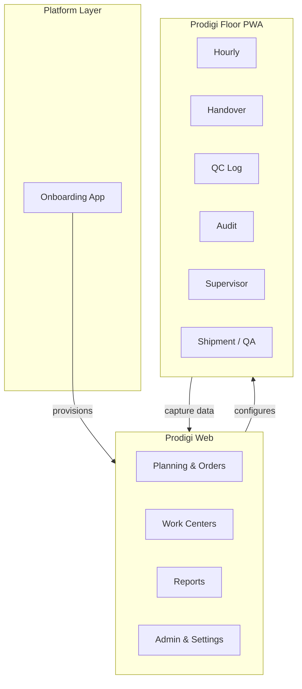

> **Speaker notes:** Compare to "one big ERP screen" — operators need 3 taps to log output, not 12 menu clicks.

---

# 3. Product Overview

Prodigi is an **ecosystem** of interconnected modules. Desktop admin configures the factory; floor apps execute production; reports close the loop.

## Module Map

| Module | Application | Primary Users |
|--------|-------------|-----------------|
| **Platform Admin** | Onboarding App | RBC superadmin |
| **Factory Control** | Prodigi Web | Factory admin |
| **Order Management** | Prodigi Web | Admin, planner |
| **Hourly Production** | Prodigi Floor | Operators |
| **Batch Production** | Prodigi Floor | Operators (batch-path departments) |
| **Quality (QC Log)** | Prodigi Floor | Operators, QC staff |
| **Audit (AQL)** | Prodigi Floor | Auditors |
| **Workforce / Supervisor** | Prodigi Floor | Supervisors |
| **Handover (Transaction)** | Prodigi Floor | Supervisors, operators (dept-dependent) |
| **Cutting (Native Origin)** | Prodigi Floor | Cutting operators |
| **Shipment / QA** | Prodigi Floor | Terminal clerks |
| **Planning** | Prodigi Web | Planner, admin |
| **Reports** | Prodigi Web | Management, admin |
| **Dashboard** | Prodigi Web | Management |
| **Work Centers** | Prodigi Web | Admin |
| **User Management** | Prodigi Web | Admin |

## How Modules Work Together

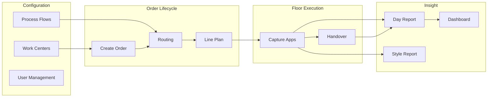

### Platform Admin (Onboarding App)

- Creates factories with unique **Factory ID** (`factories.code`)
- Sets **floor app entitlements** (which capture modes the factory may use)
- Creates the first **factory admin** (email + password)
- Optionally seeds floor users before customer handoff

### Factory Control (Prodigi Web — Admin surfaces)

- **Settings:** Shifts, support dropdowns, factory-level options
- **Work Centers:** Buyers, departments, process flow templates, operations catalog
- **User Management:** Floor users with PIN, department, role, operation assignments
- **Dashboard:** Factory-wide KPIs and cut-to-ship fulfillment

### Hourly Production

- Operators log **size-wise output** by shift hour slot
- Linked to **line allocation** (planned style on a resource/line)
- Targets derived from planning SAM and daily target
- Embedded workforce headcount on hourly/QC sessions

### Quality (QC Log)

- **Piece-wise inspection** — pass/fail/rework per size
- Defect codes from factory master
- DHU and pass-rate KPIs in reports
- Mutually exclusive with hourly output on same department+order (Output XOR QC)

### Audit (AQL)

- Optional batch sampling audit
- Does not block production flow
- Department-native app (not tied to single operation)

### Workforce / Supervisor

- Supervisors allocate **headcount categories** to lines
- View **style performance** (hour-wise KPIs, targets)
- Cutting supervisors: handover + view only (no workforce allocate)

### Batch Production

- Batch-wise count capture for departments on the batch path
- Alternative to hourly for certain work centers

### Handover (Transaction)

- **Send** pieces to next department (challan)
- **Receive** incoming slips
- **Dispute** quantity mismatches
- Mandatory for WIP integrity — next department cannot capture without receipt

### Planning

- **Planning Board:** Orders ready for line assignment
- **Production Planning:** Per-colorway Gantt allocations on resources
- **Dept. Schedule:** Cross-order department Gantt view
- **Transaction Report:** Handover slip history and status

### Reports

- **Day Report:** Department output, handovers, efficiency by date range
- **Style Report:** Full colorway lifecycle — matrix, daily charts, fulfillment

### Future Modules (Roadmap)

See [Section 19](#19-future-roadmap): AI Insights, Buyer Portal, Warehouse, Costing, Digital Twin, and more.

> **Conceptual foundation:** Before diving into individual apps, read [Section 7 — Department Classification & Capture Architecture](#7-department-classification--capture-architecture). It explains how department types, operation types, and capture methods fit together.

> **Suggested screenshot:** Prodigi Web sidebar showing Main · Production · Planning · Reports · Work Centers · Admin · System groupings.

> **Speaker notes:** Emphasize the closed loop — configuration drives capture, capture drives reports, reports drive replanning.

---

# 4. Platform Architecture

## Hierarchy Overview

Prodigi's data model follows a strict hierarchy enforced by **Row Level Security (RLS)** on every tenant table:

```
Platform (RBC / Supabase project)
  └── Factories (tenants)
        └── Departments / Work Centers
              └── Floors / Lines (assigned resources)
                    └── Users (profiles)
                          └── Apps (floor entitlements + assignments)
                                └── Data (orders, capture, handovers)
                                      └── Reports (aggregated views & RPCs)
```

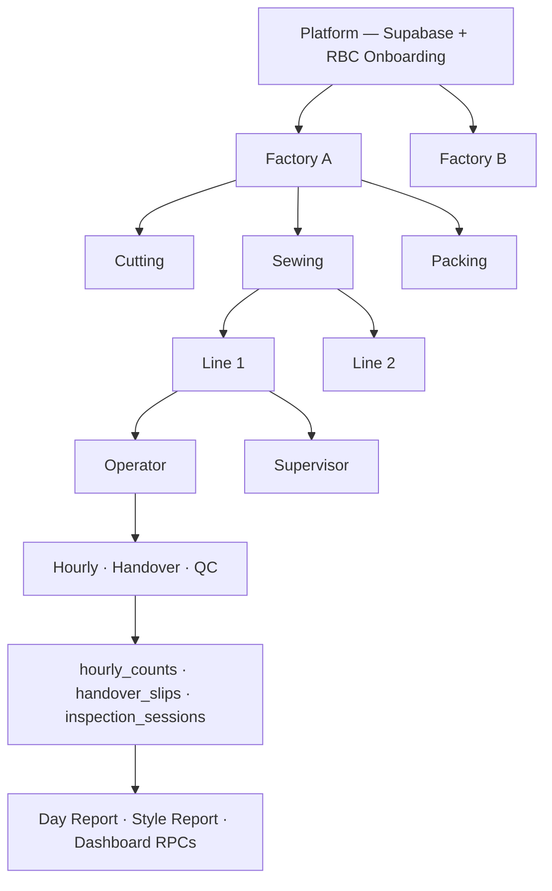

## Level-by-Level Explanation

### Platform

- Single Supabase project hosting all factories
- RBC **superadmin** provisions factories via Onboarding App (service role)
- No public self-registration — `factories` INSERT blocked for client roles
- Edge Functions for user lifecycle: `admin-create-user`, `admin-update-user`, `admin-delete-user`

### Factories

Each factory is an isolated tenant:

| Attribute | Purpose |
|-----------|---------|
| `name`, `code`, `country` | Identity; `code` = Floor login Factory ID |
| `transaction_apps` | Handover entitlement |
| `production_apps` | `hourly`, `qc_log`, `batch` |
| `workforce_apps` | `supervisor` |
| `audit_apps` | `audit` |
| `shipment_apps` | `shipment_log`, `final_rejection_log`, `shipment_audit` |

Entitlements are the **ceiling** — departments and users cannot enable apps the factory has not purchased.

### Departments (Work Centers)

- Ordered sequence in process flows
- **Role:** `origin` (cutting), `standard`, `terminal` (shipment), `store`, `outsource`
- **Apps JSONB:** Which floor capabilities are enabled (transaction, hourly, qc_log, batch, audit, supervisor, cutting_lay)
- **Operations catalog:** Named operations with `step_type` (loading, produce, store, outsource) and `capture_app`

### Floors / Lines

- **Assigned resources** (`assigned_resources`) — sewing lines, finishing tables, etc.
- Linked to a department via `department_id`
- Planning allocates styles to resources over date ranges (`line_allocations`)

### Users

Two authentication domains:

| Domain | Auth method | Roles |
|--------|-------------|-------|
| Desktop (Prodigi Web) | Email + password (Supabase Auth) | `admin`, `superadmin` |
| Floor (Prodigi Floor PWA) | Factory ID + Employee ID + PIN | `operator`, `supervisor`, `quality_manager`, `auditor` |

Profile flags (floor):

- `can_produce`, `handover_enabled`, `workforce_enabled`, `audit_enabled`, `shipment_qa_enabled`
- `floor_user_access` — junction table: one row per assigned operation

### Apps

Floor apps are **not monolithic**. They are derived from:

1. Factory entitlements (ceiling)
2. Department `apps` (capability pool)
3. User operation assignments + profile flags (actual tiles on home screen)

### Data

Core entity graph:

```
style_orders → colorways → order_routing_steps → line_allocations
                              ↓
                    hourly_counts | batch_production | inspection_sessions
                              ↓
                    handover_slips | workforce_logs | audit_sessions
                              ↓
                    shipment_logs | rejection_logs
```

**Frozen routing:** When routing is saved, `operation_name`, `step_type`, `capture_app`, and `dept_id` are frozen on `order_routing_steps` — runtime reads do not join live catalog (historical integrity).

### Reports

- Read-only RPCs and views aggregating capture tables
- Scoped by `factory_id` + date/order/department filters
- No separate data warehouse — reports query operational tables with optimized RPCs

## Three-Application Architecture

| App | Stack | Auth | Scope |
|-----|-------|------|-------|
| Onboarding App | Separate (service role server) | Superadmin email | All factories |
| Prodigi Web | Vite 6 + React 19 SPA | Admin email | One factory per session |
| Prodigi Floor | Next.js PWA (`plapps/`) | Factory ID + PIN | One user, one department |

> **Suggested diagram:** Three-app architecture box diagram (from `docs/PLATFORM_ARCHITECTURE.md`).

---

# 5. User Hierarchy

## Role Catalogue

### Platform Administrator (Superadmin)

| Attribute | Detail |
|-----------|--------|
| **DB role** | `profiles.user_role = 'superadmin'` |
| **Application** | Onboarding App (+ optional Prodigi Web for RBC factory) |
| **Scope** | All factories (via SQL / onboarding APIs) |
| **Responsibilities** | Create factories, set entitlements, create factory admins, optional floor user seeding |
| **Permissions** | Service-role operations; not exposed in customer UI |
| **Typical workflow** | Receive customer contract → provision factory → hand off credentials → support escalations |

### Organization Admin (Future — Company Layer)

| Attribute | Detail |
|-----------|--------|
| **Status** | Planned (`companies` table, `profile_factory_access`) |
| **Scope** | Multiple factories under one company |
| **Responsibilities** | Cross-plant user access, consolidated reporting |

### Factory Admin

| Attribute | Detail |
|-----------|--------|
| **DB role** | `profiles.user_role = 'admin'` |
| **Application** | Prodigi Web |
| **Scope** | Single factory (`profiles.factory_id`) |
| **Responsibilities** | Configure work centers, process flows, shifts; create orders; manage users; run reports |
| **Accessible routes** | Dashboard, Create Order, Status Tracker, Order Completion, Planning, Reports, Work Centers, User Management, Settings |
| **Typical workflow** | Morning dashboard review → approve planning → monitor day report → adjust settings |

### Department Head / Production Manager (Future Desktop Role)

| Attribute | Detail |
|-----------|--------|
| **Status** | Roadmap — `planner`, `production_manager`, `viewer` desktop RBAC |
| **Today** | Factory admin performs these functions |
| **Future permissions** | Reports + planning write, no user management |

### Supervisor

| Attribute | Detail |
|-----------|--------|
| **DB role** | `profiles.user_role = 'supervisor'` |
| **Application** | Prodigi Floor |
| **Flags** | `can_produce=false`, `handover_enabled=true`, `workforce_enabled=true` (except cutting native) |
| **Responsibilities** | Log handovers, allocate workforce headcount, review style KPIs (full mode) |
| **Accessible apps** | Handover, Supervisory app, style performance views |
| **Typical workflow** | Shift start → allocate headcount to lines → monitor hourly progress → send/receive handovers |

### Operator

| Attribute | Detail |
|-----------|--------|
| **DB role** | `profiles.user_role = 'operator'` |
| **Application** | Prodigi Floor |
| **Flags** | `can_produce=true`, `handover_enabled=false`, `audit_enabled=true` (default) |
| **Responsibilities** | Log hourly/batch/QC output for assigned operations |
| **Accessible apps** | Production groups per assigned operation, optional Audit |
| **Typical workflow** | Select operation → select line → select style → log output by hour/size |

### Quality Inspector / QC Operator

| Attribute | Detail |
|-----------|--------|
| **Implementation** | Operator on department with `qc_log` app; or dedicated QC department |
| **Capture** | `inspection_session_upsert` — piece-wise pass/fail/rework |
| **Reports** | DHU, defect Pareto, pass rate in Day Report and Style Report |

### Auditor

| Attribute | Detail |
|-----------|--------|
| **DB role** | `profiles.user_role = 'auditor'` |
| **Application** | Prodigi Floor |
| **Accessible apps** | Audit (AQL), Handover (if enabled) |
| **Responsibilities** | Run sampling audits; does not block production |

### Quality Manager (Cross-Department)

| Attribute | Detail |
|-----------|--------|
| **DB role** | `profiles.user_role = 'quality_manager'` |
| **Department** | Often null — factory-wide QC oversight |
| **Accessible apps** | QC Log, Transaction |

### Planner

| Attribute | Detail |
|-----------|--------|
| **Today** | Factory admin role on desktop |
| **Responsibilities** | Line assignment, Gantt planning, routing template application |
| **Key screens** | Planning Board, Production Planning, Dept. Schedule |

### Terminal / Shipment Clerk

| Attribute | Detail |
|-----------|--------|
| **Implementation** | User in terminal work center with `shipment_qa_enabled=true` |
| **Accessible apps** | Shipment Log, Rejection Log, Buyer Audit |
| **Responsibilities** | Log shipped quantities, rejections, pre-shipment buyer audits |

## Permission Model Summary

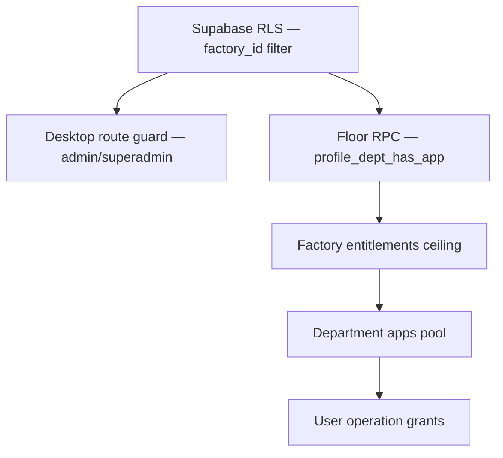

> **Speaker notes:** Security is enforced at DB (RLS + RPC), not just UI. Route guards are UX-only.

---

# 6. Factory Lifecycle

## Phase 1: Factory Onboarding (RBC)

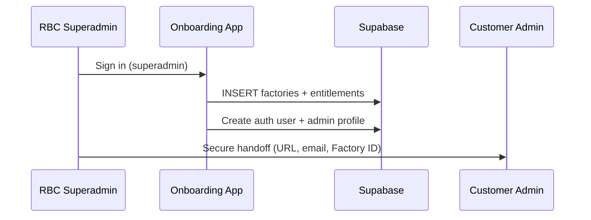

**Checklist:**

- [ ] Factory row created with app entitlement columns
- [ ] Auth user created (admin email, auto-confirmed)
- [ ] Profile linked (`factory_id`, `user_role = admin`)
- [ ] Optional: seed departments and shifts
- [ ] Floor app env configured (`FLOOR_SESSION_SECRET`, service role on server only)

## Phase 2: Configuration (Factory Admin)

1. **Settings → Shifts** — Define day/OT shifts with start/end times
2. **Work Centers → Buyers** — Buyer master with optional over-shipment allowance
3. **Work Centers → Departments** — Create work centers, enable apps, define operations catalog
4. **Work Centers → Process Flows** — Build routing templates (visits, operations, capture apps)
5. **Settings → Support Dropdowns** — Defects, garment types, wash types, etc.

## Phase 3: Department Setup

For each work center:

| Setting | Example (Sewing) |
|---------|------------------|
| Name | Sewing |
| Sequence | 3 |
| Apps | transaction, hourly, supervisor, audit |
| Operations | Loading (hourly input), Sewing (hourly produce) |
| Resources | Line 1, Line 2, Line 3 |

**Production path selection:** Hourly, Batch, or Native Cutting (origin only) — determines which capture apps appear.

## Phase 4: Floor Setup

- Create **assigned resources** (lines) per department
- Link resources to department in Work Centers

## Phase 5: Role Assignment & User Creation

**User Management** flow:

1. Enter employee ID, name, 4-digit PIN
2. Select department and floor role (operator / supervisor / auditor)
3. Assign operations (for operators) or visit apps (for supervisors)
4. System validates: `assigned_apps ⊆ department.apps ⊆ factory entitlements`
5. Edge Function creates auth user (synthetic email) + profile + `floor_user_access` rows

## Phase 6: PIN Assignment

- PIN stored hashed via `hash_floor_pin`
- Operators log in with: **Factory ID + Employee ID + PIN**
- Rate limiting on verify RPC (roadmap item)

## Phase 7: Production Activation

1. **Create Order** — Style, buyer, colorways, sizes, shipment plan
2. **Apply routing** — Process flow template → `order_routing_steps`
3. **Line planning** — Allocate colorways to lines with dates and targets
4. Floor users see planned styles on their capture apps

## Phase 8: Daily Operations

| Time | Activity | App |
|------|----------|-----|
| Shift start | Supervisor allocates workforce | Floor — Supervisory |
| Throughout shift | Operators log hourly/QC output | Floor — Hourly / QC |
| Between departments | Handover send/receive | Floor — Transaction |
| End of shift | Review day report | Web — Day Report |

## Phase 9: Reporting & Closure

- **Day Report** — Daily performance review
- **Style Report** — Per-order deep dive
- **Order Completion** — Close colorways, reconcile cut-to-ship
- **Dashboard** — Management KPIs and OTIF tracking

> **Suggested screenshot:** User Management panel showing operator with assigned operations and PIN field.

> **Demo tip:** Show the handoff email template with Factory ID highlighted — this is what operators need for floor login.

---

# 7. Department Classification & Capture Architecture

> **Read this chapter before Application Overview.** It explains the four-layer model that determines which floor apps appear in which work centers. Everything in Sections 8–13 builds on this.

Prodigi separates three concepts that are often conflated in conversation:

| Layer | Question it answers | Examples |
|-------|---------------------|----------|
| **Layer 1 — Department classification** | What *kind* of work center is this? | Origin, Standard, Store, Outsource, Terminal |
| **Layer 2 — Operation type** | What *step* within a work center? | Loading, Produce, Store, Outsource |
| **Layer 3 — Capture method** | *How* is data entered on a step? | Hourly, QC Log, Batch, Cutting Lay, Shipment QA, Outsource |
| **Layer 4 — Global capabilities** | What is *always available* regardless of type? | Transaction (handover), Audit, Supervisory app |

Layers 1–3 are **nested**. Layer 4 is **orthogonal** — it applies across department types (with documented exceptions below).

---

## 7.1 The Four Layers (Conceptual Model)

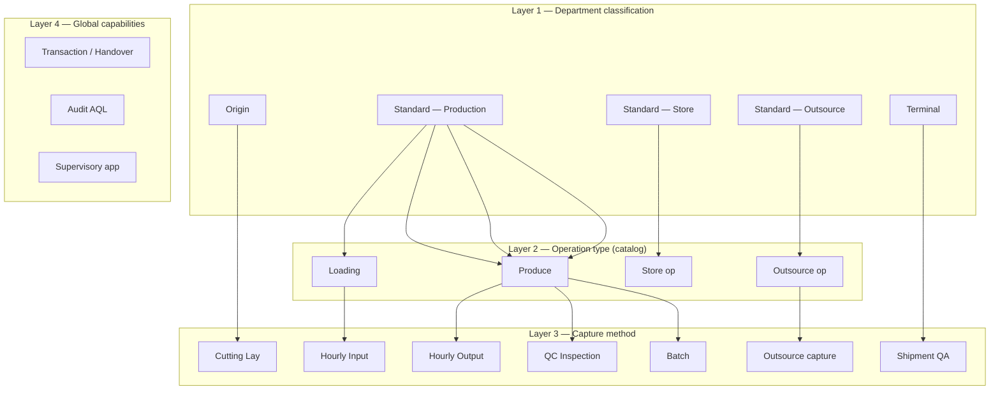

---

## 7.2 Layer 1 — Department Classification

Every work center (`departments` row) has a structural **`role`** that defines its position in the process flow:

| `role` | Name | Position in flow | First-class type? |
|--------|------|------------------|-------------------|
| `origin` | **Origin** | First visit (typically Cutting) | **Yes** — not a flag on Standard |
| `standard` | **Standard** | Middle visits | **Yes** — further classified by `planning_mode` |
| `terminal` | **Terminal** | Last visit (Shipment / Dispatch) | **Yes** — not a flag on Standard |

> **Important:** Origin and Terminal are **separate department types** stored in `departments.role`. They are not special cases of Standard — they are peer classifications with different floor behaviour, planning rules, and capture apps.

### Standard departments — three planning modes

Standard work centers (`role = standard`) are further classified by **`planning_mode`**:

| `planning_mode` | Common name | Floor behaviour |
|-----------------|---------------|-----------------|
| `production` | **Standard Production** | Loading + Produce operations; operators capture output |
| `storage` | **Store** | Passive — handover + supervisor only; no operator production capture |
| `outsource` | **Outsource** | Passive supervisor + vendor two-leg handover; optional outsource capture op |

This gives **five effective department kinds** in practice:

```
Origin          (role = origin)
Standard Production   (role = standard, planning_mode = production)
Store           (role = standard, planning_mode = storage)
Outsource       (role = standard, planning_mode = outsource)
Terminal        (role = terminal)
```

### Canonical hierarchy (presentation diagram)

```
Work Center (Department)
│
├── Origin  ──────────────────────────  role = origin
│     └── Cutting capture (Lay Report)
│
├── Standard — Production  ─────────────  role = standard, planning_mode = production
│     │
│     ├── Loading operation
│     │      └── Hourly Input
│     │
│     └── Produce operation(s)
│            ├── Hourly Output
│            ├── QC Inspection
│            └── Batch Production
│
├── Standard — Store  ──────────────────  role = standard, planning_mode = storage
│     └── Store operation (handover-only — no produce capture)
│
├── Standard — Outsource  ──────────────  role = standard, planning_mode = outsource
│     └── Outsource operation
│            └── Outsource capture (two-leg handover)
│
└── Terminal  ────────────────────────  role = terminal
      └── Shipment / QA capture
```

### DB fields (for implementers)

| Field | Table | Values |
|-------|-------|--------|
| `role` | `departments` | `origin` \| `standard` \| `terminal` |
| `planning_mode` | `departments` | `production` \| `storage` \| `outsource` \| `native_cutting` \| `native_shipment` |
| `isNative` | UI / derived | Native cutting or shipment UX paths |

`planning_mode` is **derived from `role`** when not explicitly set: `origin` → `native_cutting`, `terminal` → `native_shipment`.

---

## 7.3 Layer 2 — Operation Type

Operations live in the **operations catalog** per department (`operations` table). Each operation has a **`step_type`**:

| `step_type` | Applies to | Purpose |
|-------------|------------|---------|
| `loading` | Standard Production departments | WIP arriving / being loaded onto a line — **input** count |
| `produce` | Standard Production, Origin, Terminal | Value-add work — **output** count |
| `store` | Store departments | Intermediate storage — **no capture app**; handover only |
| `outsource` | Outsource departments | External processing — triggers two-leg handover flow |

**Rules:**

- **Loading and Produce** exist only on **Standard Production** departments (and are the primary operation pattern there).
- **Origin** departments use **Produce** operations with `capture_app = cutting_lay` (not Loading/Produce pair).
- **Terminal** departments use **Produce** operations with `capture_app = shipment_qa`.
- **Store** departments have **Store** operations — no hourly/QC/batch capture.
- **Outsource** departments have **Outsource** operations — vendor send/return via handover.

Operations are grouped into **visits** on the order route (`visit_id` on `order_routing_steps`). A visit is one pass through a work center and may contain multiple operations (e.g., Loading then Sewing in the same Sewing visit).

---

## 7.4 Layer 3 — Capture Method

Capture method is stored as **`capture_app`** on each catalog operation. It defines *how* the floor app records data for that operation.

| `capture_app` | Operation type | Label on floor | XOR rule |
|---------------|----------------|----------------|----------|
| `hourly` | `loading` | Hourly **Input** | One session per dept+order |
| `hourly` | `produce` | Hourly **Output** | One session per dept+order |
| `qc_log` | `produce` | QC Inspection | Mutually exclusive with hourly on same dept+order |
| `batch` | `produce` | Batch Production | Alternative to hourly path |
| `cutting_lay` | `produce` (origin) | Lay Report | Origin-only |
| `shipment_qa` | `produce` (terminal) | Shipment / QA | Terminal-only |
| `outsource` | `outsource` | Outsource vendor | Outsource dept |
| `transaction` | (routing handover step) | Handover | Not a produce session |
| — | `store` | *(none)* | Handover only |

### Production path (Standard Production only)

A Standard Production department typically adopts **one primary output path** configured via its operations catalog:

| Path | Produce `capture_app` | When to use |
|------|----------------------|-------------|
| Hourly | `hourly` | Sewing, finishing, packing — hour-by-hour tally |
| QC-first | `qc_log` | Finishing, inline inspection-heavy work |
| Batch | `batch` | Batch ovens, washing batches, non-hourly output |

The department may have **multiple produce operations** with different capture apps (e.g., Block Cut = hourly, Final Trim = qc_log). The operator selects the operation on the floor home screen.

### Allowed capture apps by step type (defaults)

| step_type | Allowed capture apps |
|-----------|---------------------|
| `loading` | `hourly` only |
| `produce` | `hourly`, `qc_log`, `batch`, `cutting_lay`, `shipment_qa` |
| `store` | *(none)* |
| `outsource` | `outsource` |

Factory **entitlements** (`factories.production_apps`, etc.) further restrict which capture apps a factory may use.

---

## 7.5 Layer 4 — Global Capabilities

These are **department-native apps** — not tied to a single catalog operation. They apply across department types with the exceptions noted below.

| Capability | App ID | Default | Applies to |
|------------|--------|---------|------------|
| **Transaction (Handover)** | `transaction` | **Always on** | All types except Terminal |
| **Audit (AQL)** | `audit` | Available if factory entitled | Production + Origin operators (optional per user) |
| **Supervisory app** | `supervisor` | Available if factory entitled | Production, Origin, Store, Outsource — **not Terminal** |

> **Every department, regardless of type, supports Transaction (handover) and may support Audit** — subject to factory entitlements and user assignment. Terminal is the exception: terminal clerks use Shipment / QA instead of visit handover.

### Additional apps by department kind

| Department kind | Extra apps beyond global capabilities |
|-----------------|--------------------------------------|
| **Origin** | `cutting_lay` (Lay Report) |
| **Standard Production** | Derived from operations: `hourly`, `qc_log`, `batch` |
| **Store** | *(none — handover + supervisor only)* |
| **Outsource** | `outsource` vendor capture |
| **Terminal** | `shipment_log`, `final_rejection_log`, `shipment_audit` (factory functions) |

### Composition rule

The floor home screen for a user is:

```
Visible tiles = (assigned operations → capture apps)
              ∪ (global capabilities enabled for user)
              ∩ (department apps pool)
              ∩ (factory entitlements ceiling)
```

---

## 7.6 Complete Matrix — Department Kind × Layers

| Department kind | Layer 2 operations | Layer 3 capture | Layer 4 global |
|-----------------|-------------------|---------------|----------------|
| **Origin** | Produce (cutting) | `cutting_lay` | Transaction, Audit, Supervisor |
| **Standard Production** | Loading + Produce | `hourly` (in/out), `qc_log`, `batch` | Transaction, Audit, Supervisor |
| **Store** | Store | *(none)* | Transaction, Supervisor |
| **Outsource** | Outsource | `outsource` | Transaction, Supervisor |
| **Terminal** | Produce (dispatch) | `shipment_qa` + shipment functions | *(no handover / audit / supervisor)* |

---

## 7.7 How Routing Uses This Model

When a **process flow template** is applied to an order:

1. Each **visit** maps to one work center (department).
2. Each **step** within the visit maps to one **catalog operation** (`operation_def_id`).
3. On save, `step_type`, `capture_app`, and `operation_name` are **frozen** on `order_routing_steps`.
4. The floor app resolves capture UI from the frozen `capture_app` on the selected route step.

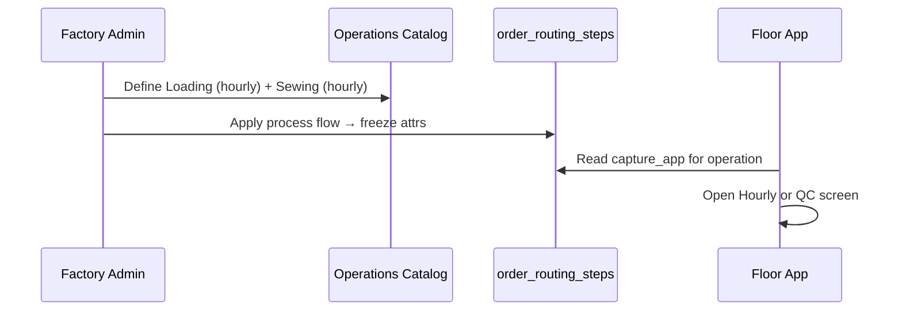

---

## 7.8 Common Confusions — Resolved

| Confusion | Clarification |
|-----------|---------------|
| "Store is a department type" | Store is a **`planning_mode`** on a **`role = standard`** department, not a separate `role` value |
| "Outsource is a department type" | Same — `planning_mode = outsource` on Standard |
| "Origin is just cutting on a standard dept" | **No** — Origin has `role = origin` with distinct sequence rules (pinned first in route) |
| "Terminal is just shipment on a standard dept" | **No** — Terminal has `role = terminal` (pinned last in route) |
| "Hourly is a department app" | Hourly is a **capture method** on Loading/Produce **operations**; it appears in department `apps` as a derived capability |
| "Transaction is optional" | Transaction is **always included** for non-terminal departments; it is the handover spine |
| "A dept can run hourly and QC simultaneously" | **No** — Output XOR QC at department+order session level |
| "step_type Store vs planning_mode storage" | `step_type = store` is an **operation** in the catalog; `planning_mode = storage` classifies the **department** |

---

## 7.9 Presentation Slide — One-Page Summary

**Title:** Department Classification & Capture Architecture

**Diagram:** Use the canonical hierarchy tree from §7.2.

**Key talking points:**

1. Five department kinds: Origin, Standard Production, Store, Outsource, Terminal.
2. Standard Production has Loading (hourly input) and Produce (hourly output, QC, or batch).
3. Origin adds Cutting; Terminal adds Shipment — both are first-class roles, not flags.
4. Every non-terminal department gets Transaction and may get Audit — regardless of production path.
5. Capture method is chosen per **operation** in the catalog, not per department name.

**Speaker notes:** "Once you understand this tree, every app chapter that follows becomes obvious — we're not listing random features, we're showing how each layer executes."

> **Suggested screenshot:** Work Centers → Department editor showing role/planning_mode selector and operations catalog with step_type + capture_app columns.

---

# 8. Application Overview

Each application chapter follows the same structure for presentation reuse.

---

## 8.1 Platform Admin (Onboarding App)

### Purpose

Secure, RBC-only factory provisioning. Creates tenants without exposing service-role keys to customer browsers.

### Business Problem

Self-service factory signup is a security risk (open `factories` INSERT, unvalidated admin creation). Enterprise customers expect white-glove onboarding.

### Users

RBC platform operators (`superadmin`).

### Workflow

1. Sign in with superadmin credentials
2. Add factory (name, code, country, app entitlements)
3. Create factory admin (email, password, full name)
4. Optional: seed departments and floor users
5. Hand off credentials via secure channel

### Navigation

Standalone app — not part of Prodigi Web sidebar.

### Major Screens

- Factory list
- Create / edit factory form (entitlement checkboxes)
- Create admin user form
- Optional floor user seed form

### Important Features

- App entitlement configuration at creation time
- Service-role API routes (server-side only)
- Superadmin gate after login

### Configuration

Entitlement columns on `factories` — see `docs/FACTORY_APP_ENTITLEMENTS.md`.

### Data Inputs

Factory name, code, country, entitlement arrays, admin email/password.

### Outputs

Factory UUID, Factory ID (code), admin credentials.

### Reports

None — operational provisioning tool.

### Benefits

- Minutes to onboard vs. manual SQL
- Consistent entitlement defaults
- Audit trail (future: `audit_events`)

### KPIs

- Time to provision factory
- Factories onboarded per month

### Dependencies

Supabase service role, Auth admin API.

### Future Enhancements

- Self-service billing integration
- Factory health dashboard
- Entitlement change audit log

### Suggested Screenshots

- Onboarding login screen
- Factory creation form with entitlement toggles
- Admin user creation confirmation

### Speaker Notes

"This app never ships to customers. It is how RBC provisions your private factory instance."

### Presentation Notes

Keep this section brief in client demos — mention it exists for security, do not demo unless audience is technical.

---

## 8.2 Factory Control (Prodigi Web — Admin Hub)

### Purpose

Central administration for a single factory: settings, work centers, users, and operational oversight.

### Business Problem

Factory managers need one place to configure the plant before any floor capture works.

### Users

Factory admin (`admin`).

### Workflow

Settings → Work Centers → User Management → ongoing Dashboard/Reports monitoring.

### Navigation

Sidebar groups: Main, Production, Planning, Reports, Work Centers, Admin, System.

### Major Screens

| Screen | Route |
|--------|-------|
| Dashboard | `#/dashboard` |
| Settings | `#/settings` |
| Work Centers | `#/work-centers` |
| User Management | `#/user-management` |

### Important Features

- Unsaved-changes protection on navigation
- TanStack Query bootstrap for settings and factory data
- Factory-scoped RLS on all reads/writes

### Configuration

Shifts, support dropdowns, department operations, process flows.

### Data Inputs

Master data CRUD via settings and work center editors.

### Outputs

Configured factory ready for order creation and floor capture.

### Reports

Dashboard aggregates cut-to-ship and factory KPIs.

### Benefits

- Single admin surface — no scattered config files
- Changes propagate to floor on next login/bootstrap

### KPIs

- Active users count
- Departments configured
- Orders in production

### Dependencies

Onboarding provisioning complete.

### Future Enhancements

- Multi-factory switcher for company admins
- Role-based desktop permissions (planner, viewer)

### Suggested Screenshots

- Full sidebar navigation
- Settings shifts editor
- Work Centers tabbed view

### Speaker Notes

"Everything the plant manager configures before operators touch a tablet lives here."

---

## 8.3 Hourly Production (Floor App)

### Purpose

Capture **size-wise production output** by shift hour for assigned operations.

### Business Problem

Paper tally sheets are late, error-prone, and disconnected from planning targets.

### Users

Operators (`can_produce=true`) with hourly operations assigned.

### Workflow

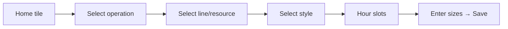

### Navigation

`/floor/home` → production group → `/floor/hourly` → `/floor/hourly/[orderId]/capture`

### Major Screens

- Style selection hub (`/floor/hourly`)
- Style detail with progress
- Hour slot grid
- Capture form with size split table

### Important Features

- Balance cap: cannot exceed planned minus already produced
- OT shift requires workforce logged first
- `hourly_upsert` RPC with `order_route_id` identity
- Embedded workforce headcount (supervisor path separate)

### Configuration

Department must have `hourly` in apps; operation `capture_app = hourly`; user granted operation in `floor_user_access`.

### Data Inputs

| Field | Required |
|-------|----------|
| orderId | Yes |
| colorwayId | Yes |
| departmentId | Yes |
| operationId (order_route_id) | Yes |
| shiftId | Yes |
| hourSlot | Yes |
| logDate | Yes |
| countBySize | Yes |
| resourceId | Recommended |

### Outputs

`hourly_counts` rows; updated WIP pool for handover; Day Report output sections.

### Reports

Day Report hourly tables, Style Report daily charts, Dashboard efficiency trends.

### Benefits

- Real-time output visibility
- Size-level granularity for buyer compliance
- Target vs. actual per hour

### KPIs

- Hourly output qty
- Efficiency % (actual vs. SAM-based target)
- Cumulative day output

### Dependencies

Line allocation exists for style on resource; routing step with `capture_app=hourly`.

### Future Enhancements

- Barcode scan for bundle tracking
- Voice confirmation for high-volume lines

### Suggested Screenshots

- Hour slot grid with filled/empty states
- Size split capture form
- Style progress header showing planned vs. produced

### Speaker Notes

"Three taps from home to logging pieces — designed for gloves and factory lighting."

### Presentation Notes

Live demo: log 50 pieces on size M for hour 10:00–11:00; show immediate reflection in Day Report.

---

## 8.4 Quality — QC Log (Floor App)

### Purpose

Piece-wise quality inspection with defect logging.

### Business Problem

Quality data collected on paper cannot be aggregated into DHU or defect Pareto until days later.

### Users

Operators or dedicated QC staff on departments with `qc_log`.

### Workflow

Home → QC operation → style → inspect screen → pass/fail/rework per piece/size with defect codes.

### Navigation

`/floor/quality/inspect?order=&colorway=&operation=`

### Major Screens

- QC style hub (via hourly hub with `from=quality`)
- Inspection session screen
- QC history and analytics tabs

### Important Features

- **Output XOR QC:** Cannot run QC and hourly simultaneously on same dept+order
- Defect master from Settings
- Session-based upsert (`inspection_session_upsert`)

### Configuration

Department `qc_log` enabled; operation assigned `capture_app=qc_log`.

### Data Inputs

Order, colorway, operation, size, result (pass/fail/rework), defect code, inspector.

### Outputs

`inspection_sessions`, defect aggregates.

### Reports

DHU, pass rate, defect Pareto (Day Report, Style Report).

### Benefits

- Quality at source
- Immediate defect visibility for line correction

### KPIs

- DHU (Defects per Hundred Units)
- First-pass yield
- Top 5 defects

### Dependencies

Defects configured in Settings; routing step with QC capture app.

### Future Enhancements

- Photo capture for defects
- Automatic line stop triggers (configurable)

### Suggested Screenshots

- QC inspect screen with defect picker
- QC analytics tab

### Speaker Notes

"When Sewing switches to QC mode, hourly output stops — one truth, one session."

---

## 8.5 Audit — AQL (Floor App)

### Purpose

Optional Acceptable Quality Level batch sampling audit.

### Business Problem

Buyer audits require structured sampling records separate from inline QC.

### Users

Auditors (`user_role=auditor`) or operators with `audit_enabled`.

### Workflow

Select style → run audit session → sample sizes → record findings.

### Navigation

`/floor/audit/[orderId]/run` or via hourly hub `from=audit`

### Major Features

- Does not block production flow
- Department-native (not operation-scoped)
- Separate from QC log sessions

### Configuration

Factory `audit_apps` entitlement; department has audit capability; user `audit_enabled=true`.

### Data Inputs

Sample size, accept/reject counts, audit criteria.

### Outputs

`audit_sessions` records.

### Reports

Audit summary in Style Report (where implemented).

### Benefits

- Structured AQL compliance
- Audit trail for buyer disputes

### KPIs

- Audit pass rate
- Samples completed vs. planned

### Dependencies

Audit entitlement enabled at factory level.

### Future Enhancements

- Buyer-specific AQL tables
- Certificate PDF export

### Suggested Screenshots

- Audit run screen
- Sample size selector

---

## 8.6 Workforce / Supervisory App (Floor App)

### Purpose

Supervisors allocate workforce headcount to lines and review style performance.

### Business Problem

Efficiency calculations require knowing how many operators were present — not just output counts.

### Users

Supervisors (`workforce_enabled=true`, supervisor role).

### Workflow

Visit-first: select line → allocate headcount categories → view style KPIs (full mode).

### Navigation

Supervisor home tile → `/floor/workforce/[resourceId]/log`

### Major Features

- Headcount by workforce category
- Style performance detail (hour-wise for supervisors)
- Cutting supervisor exception: view + handover only, no allocate

### Configuration

Department has `supervisor` app; factory workforce entitlement.

### Data Inputs

Resource ID, shift, date, category headcounts.

### Outputs

`workforce_logs` linked to line allocations.

### Reports

Efficiency calculations in Day Report (workforce-adjusted).

### Benefits

- Accurate efficiency = output ÷ (headcount × SAM)
- Supervisor accountability for line staffing

### KPIs

- Workforce utilization
- Efficiency % by line
- Headcount vs. plan variance

### Dependencies

Workforce categories configured; line allocations exist.

### Future Enhancements

- Integration with biometric attendance
- Auto-suggest headcount from historical efficiency

### Suggested Screenshots

- Workforce allocate screen
- Supervisor style performance (full mode)

---

## 8.7 Batch Production (Floor App)

### Purpose

Batch-wise production count for departments on the batch path (alternative to hourly).

### Business Problem

Some departments (e.g., washing batches, oven curing) do not produce hourly — they produce per batch.

### Users

Operators with batch capture operations assigned.

### Workflow

Select operation → style → enter batch count (with embedded headcount on batch session).

### Configuration

Factory `production_apps` includes `batch`; operation `capture_app=batch`.

### Data Inputs

Batch quantity, session metadata, optional size split.

### Outputs

`batch_production` session rows.

### Reports

Included in production summary RPCs alongside hourly.

### Benefits

- Correct capture model for non-hourly departments
- Same routing and handover spine

### KPIs

- Batch completion count
- Batch cycle time (future)

### Suggested Screenshots

- Batch capture screen

---

## 8.8 Handover / Transaction (Floor App)

### Purpose

Mandatory WIP movement logging between departments — the integrity spine of Prodigi.

### Business Problem

Pieces vanish between departments; accountability is unclear; buyer audits fail WIP reconciliation.

### Users

Supervisors (`handover_enabled=true`); some departments enable operator handover.

### Workflow

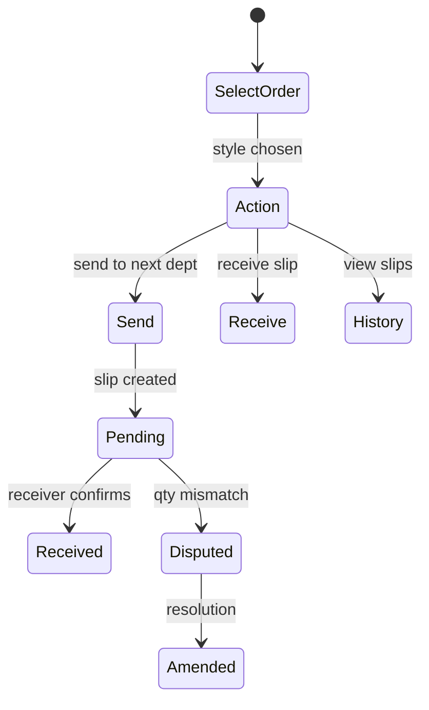

### Navigation

`/floor/transaction` — visit-first (not operation-first)

### Major Screens

- Order selection
- Action menu (Send / Receive / History)
- Send form with size split
- Receive confirmation
- Dispute detail and amend

### Important Features

- Two-leg outsource handover (out + return)
- Dispute workflow with amend/accept
- `handover_send`, `handover_receive`, `handover_amend` RPCs
- Next department blocked until receive confirmed

### Configuration

Department has `transaction` app (always on by default); user `handover_enabled`.

### Data Inputs

Order, colorway, from/to department, operation, quantities by size, notes.

### Outputs

`handover_slips` with status: pending, received, disputed, received_disputed.

### Reports

Transaction Report, Day Report handover tables, Style Report journey section.

### Benefits

- Full WIP traceability
- Dispute visibility — not hidden in spreadsheets

### KPIs

- Handover compliance rate
- In-transit WIP aging
- Dispute rate and resolution time

### Dependencies

Order routing defines next department; primary output flag drives WIP pool.

### Future Enhancements

- QR code on challan print
- GPS stamp for outsource pickups

### Suggested Screenshots

- Send handover form
- Disputed slip detail
- Transaction Report with status badges

### Speaker Notes

"This is Prodigi's moat — without handover, you have another tally app."

---

## 8.9 Cutting — Native Origin (Floor App)

### Purpose

Lay report capture at the origin (cutting) work center.

### Business Problem

Cutting is the source of truth for piece count — must be captured differently from sewing hourly.

### Users

Cutting operators with `cutting_lay` operations.

### Workflow

`/floor/cutting?operationDef=` → lay report entry → bundles generated as outcome.

### Configuration

Department role = `origin`; operation `capture_app=cutting_lay`.

### Data Inputs

Lay details, fabric components, cut quantities by size.

### Outputs

`cutting_sessions`; feeds cut-to-ship reconciliation.

### Reports

Style Report fabric/cut sections, Dashboard cut-to-ship, Order Completion.

### Benefits

- Accurate cut qty for fulfillment metrics
- Fabric component breakdown (where configured)

### KPIs

- Cut qty vs. adjusted order qty
- Order-to-cut %

### Suggested Screenshots

- Cutting lay report screen
- Fabric output breakdown popover (desktop)

---

## 8.10 Shipment / QA (Floor App — Terminal)

### Purpose

Log shipped quantities, final rejections, and buyer pre-shipment audits at terminal work center.

### Business Problem

Shipment data arrives too late for OTIF correction; rejections not linked to order/colorway.

### Users

Terminal clerks with `shipment_qa_enabled=true`.

### Workflow

`/floor/shipment/styles?mode=ship|audit` → order/colorway → log quantities.

### Major Features

- Single grant unlocks all factory `shipment_apps`
- Dispatch operation in routing for terminal visit
- Buyer audit mode separate from ship mode

### Configuration

Terminal department role; factory shipment entitlement; user shipment QA flag.

### Data Inputs

Shipped qty by size, rejection reasons, audit findings.

### Outputs

Shipment logs, rejection logs, colorway ship close events.

### Reports

Cut-to-ship, OTIF, Style Report fulfillment section.

### Benefits

- OTIF tracked from same system as production
- Buyer audit trail

### KPIs

- Shipped qty vs. order qty
- On-time in-full (OTIF)
- Rejection rate at shipment

### Suggested Screenshots

- Shipment styles list (ship mode)
- Buyer audit screen

---

## 8.11 Order Management (Prodigi Web)

### Purpose

Create and manage style orders with colorways, sizes, and shipment plans.

### Business Problem

Orders scattered in Excel cannot drive floor routing or planning.

### Users

Factory admin, planner.

### Workflow

Create Order → fill header → add colorways/sizes → shipment plan → save → routing → planning.

### Navigation

`#/create-order`, `#/style-details/:id`, `#/style-color-details/:id/:colorId`

### Major Screens

- Order header (buyer, PO, dates, SAM)
- Colorway workspace with size grid
- Shipment plan section
- Validation summary
- Style details (production matrix)
- Status Tracker list

### Important Features

- Cutting allowance and over-shipment allowance
- Atomic save via `save_style_order` RPC
- Order routing editor embedded in style flow

### Data Inputs

Style name, PO, buyer, colorways, sizes, quantities, shipment plan lines.

### Outputs

`style_orders`, `colorways`, shipment plan JSON.

### Reports

Style Report, Status Tracker, Dashboard order lists.

### Benefits

- Single order record drives entire lifecycle
- Validation before save prevents incomplete orders

### KPIs

- Orders created per week
- Average colorways per order

### Suggested Screenshots

- Create Order form with colorway grid
- Style Details production matrix
- Status Tracker pipeline view

---

## 8.12 Planning (Prodigi Web)

### Purpose

Assign orders to lines over time with targets derived from SAM and workforce.

### Business Problem

Without line-level plans, floor apps have nothing to show operators — "what should I sew today?"

### Users

Planner, factory admin.

### Workflow

Planning Board → select order → Production Planning → assign lines/dates → save plan.

### Navigation

`#/line-assignment`, `#/planning-detail`, `#/dept-schedule`

### Major Screens

- Planning order list
- Production planning Gantt (per colorway)
- Department schedule Gantt (cross-order)
- Order routing editor panel

### Important Features

- `save_line_plan` RPC with allocation payloads
- Daily target override
- KPI inputs: workforce, SAM, efficiency, productivity
- Routing template apply via `save_order_routing`

### Data Inputs

Resource, dates, qty, daily target, SAM, workforce, routing step reference.

### Outputs

`line_allocations` rows linked to orders and routing steps.

### Reports

Gantt actuals overlay, planning vs. actual in Style Report.

### Benefits

- Floor sees planned styles immediately
- Targets enable efficiency measurement

### KPIs

- Plan adherence %
- Lines utilized
- Planned vs. actual output

### Suggested Screenshots

- Production Planning Gantt with allocation bars
- Dept. Schedule multi-order view
- Routing editor with visit groups

---

## 8.13 Reports (Prodigi Web)

### Purpose

Transform floor capture into management insight.

### Business Problem

Data exists on floor but management needs aggregated, filterable views.

### Users

Factory admin, management (future: read-only viewer role).

### Workflow

Reports landing → select Day or Style Report → apply filters → drill down → export CSV.

### Navigation

`#/reports`, `#/reports/day`, `#/reports/style`

### Major Screens

- Reports landing with catalog stats
- Day Report (department cards, handover tables, charts)
- Style Report (matrix, daily charts, fulfillment, journey)

### Benefits

- Same-day visibility — no overnight Excel
- Consistent KPI definitions

### KPIs

See Section 18.

### Suggested Screenshots

- Day Report department card expanded
- Style Report production matrix
- Style fulfillment metrics bar

---

## 8.14 Dashboard (Prodigi Web)

### Purpose

Executive snapshot of factory health — fulfillment, output trends, active orders.

### Users

Management, factory admin.

### Navigation

`#/dashboard`

### Major Widgets

- KPI cards: active orders, fulfillment %, cut-to-ship, efficiency, WIP
- Daily trend chart
- Efficiency line chart
- Cut-to-ship order list with search and buyer filter
- Date range picker

### Benefits

- One-screen morning review
- Click-through to Status Tracker / reports

### Suggested Screenshots

- Dashboard with 6 KPI cards and charts populated

---

## 8.15 Order Completion (Prodigi Web)

### Purpose

Close colorways, reconcile quantities, finalize cut-to-ship for OTIF measurement.

### Users

Factory admin, production manager.

### Navigation

`#/production/order-completion`

### Major Features

- Colorway closure workflow
- Shipment actual vs. plan reconciliation
- Department schedule review per order

### Benefits

- Clean OTIF denominator (closed colorways only)
- Prevents stale WIP on completed styles

### Suggested Screenshots

- Order Completion workspace with colorway status panels

---

## 8.16 Floor Day Board (Prodigi Web)

### Purpose

Desktop view of today's floor activity — what is running on each line.

### Users

Factory admin, floor manager.

### Navigation

`#/floor-day` (Floor Day Board)

### Benefits

- Management visibility without going to floor
- Links to order details

---

## 8.17 Future Modules (Summary)

| Module | Status | Description |
|--------|--------|-------------|
| Company / HQ layer | Schema backlog | Multi-factory org admin |
| Platform Admin UI | Planned | In-app factory switcher for superadmin |
| Desktop RBAC expansion | Planned | planner, viewer, production_manager roles |
| Attendance integration | Partial | Workforce categories; biometric TBD |
| Buyer Portal | Roadmap | Read-only WIP for buyers |
| AI Insights | Roadmap | Anomaly detection on efficiency |

---

# 9. Detailed Workflow

## 9.1 End-to-End Production Workflow

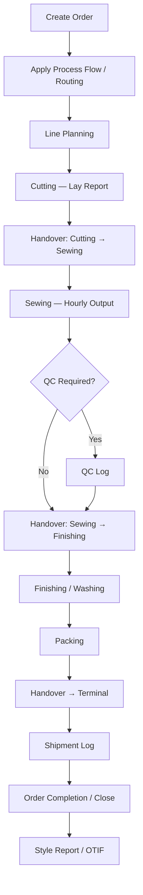

## 9.2 Stage-by-Stage App Participation

| Stage | Desktop App | Floor App | Key Data |
|-------|-------------|-----------|----------|
| Order Creation | Create Order | — | style_orders, colorways |
| Routing | Style Details / Routing Editor | — | order_routing_steps |
| Planning | Production Planning | — | line_allocations |
| Cutting | Style Details (view) | Cutting Lay | cutting_sessions |
| Handover Out | Transaction Report (view) | Transaction Send | handover_slips |
| Sewing Output | Floor Day Board | Hourly | hourly_counts |
| Inline QC | Style Report | QC Log | inspection_sessions |
| Supervisor Staffing | — | Workforce | workforce_logs |
| AQL Audit | — | Audit | audit_sessions |
| Handover In | Transaction Report | Transaction Receive | handover_slips.status |
| Outsourced Process | Transaction Report | Transaction (2-leg) | handover_slips |
| Shipment | Order Completion | Shipment Log | shipment_logs |
| Rejection | Style Report | Rejection Log | rejection_logs |
| Closure | Order Completion | — | colorway completion status |
| Analysis | Dashboard, Reports | — | aggregated RPCs |

## 9.3 Order Creation Workflow (Detailed)

1. Admin opens **Create Order** (`#/create-order`)
2. Select buyer from Work Centers master
3. Enter style name, PO number, order date, garment type, SAM
4. Add colorways via Colorway Workspace — sizes and quantities per color
5. Configure shipment plan lines (date, mode, sizes per shipment)
6. Validation summary checks required fields
7. Save → `save_style_order` RPC persists atomically
8. Navigate to Style Details for routing

**Apps involved:** Prodigi Web only  
**Output:** Order ready for routing and planning

## 9.4 Planning Workflow (Detailed)

1. Open **Planning Board** — list of orders needing line assignment
2. Select order → **Production Planning** (`#/planning-detail`)
3. Review/edit **order routing** (apply template or customize visits)
4. For each colorway: drag allocation bars onto line Gantt
5. Set dates, qty, daily target, workforce, SAM
6. Save Plan → `save_line_plan` RPC
7. Floor apps hydrate allocations — styles appear on operator hubs

**Apps involved:** Prodigi Web (planning), Prodigi Floor (reads allocations)

## 9.5 Cutting Workflow

1. Cutting operator logs in (Floor)
2. Select cutting operation (lay report)
3. Choose planned style from allocation list
4. Enter lay details and cut quantities by size
5. System records `cutting_sessions`
6. Supervisor sends handover to Sewing

**Apps involved:** Floor Cutting, Floor Handover  
**Gate:** Sewing cannot receive without Cutting send

## 9.6 Sewing Production Workflow

1. Sewing operator selects hourly operation
2. Select line → select style → hour slot
3. Enter output by size (capped by balance)
4. Optional: supervisor logged workforce for efficiency
5. End of lot: supervisor sends handover to next visit

**Apps involved:** Floor Hourly, Floor Workforce (supervisor), Floor Handover

## 9.7 QC Workflow

1. Department switches to QC mode (QC operation on routing)
2. Operator opens QC inspect for style/colorway
3. Log pass/fail/rework with defect codes
4. DHU available immediately in reports

**Rule:** Output XOR QC — hourly stops while QC session active

## 9.8 Shipment Workflow

1. Terminal clerk opens Shipment app
2. Select order/colorway in ship mode
3. Log shipped quantities by size
4. Admin reviews in Order Completion
5. Close colorway → OTIF calculated against shipment plan date

## 9.9 Outsourced Department Workflow

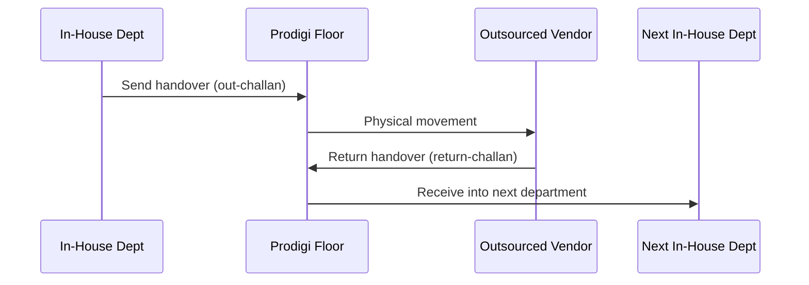

Two-leg handover preserves WIP traceability through external processing.

> **Speaker notes:** Walk one PO number through every stage — audience remembers the story, not the feature list.

---

# 10. Data Captured

## 10.1 Hourly Production

| Column / Field | Purpose | Validation | Required | Used in Reports | Generated KPI |
|----------------|---------|------------|----------|-----------------|---------------|
| factory_id | Tenant scope | RLS | Yes | All | — |
| order_id | Style reference | FK | Yes | Day, Style | — |
| colorway_id | Color reference | FK | Yes | Day, Style | — |
| order_route_id | Routing step | FK | Yes | Matrix columns | Operation output |
| department_id | Work center | FK | Yes | Day dept cards | — |
| line_allocation_id | Planned row | FK | Recommended | Planning vs actual | — |
| resource_id | Line | FK | Optional | Line efficiency | — |
| shift_id | Shift | FK | Yes | Day | — |
| hour_slot | Hour bucket | Enum | Yes | Hourly tables | Hourly output |
| log_date | Business date | Date | Yes | Date filters | Daily output |
| count | Total pieces | > 0 | Yes | All output KPIs | Output qty |
| count_by_size | Size split | JSON | Yes | Size matrix | Size fulfillment |
| logged_at | Timestamp | ISO | Yes | Audit | — |

## 10.2 QC Log (Inspection)

| Column / Field | Purpose | Validation | Required | Used in Reports | Generated KPI |
|----------------|---------|------------|----------|-----------------|---------------|
| order_id | Style | FK | Yes | Style QC | — |
| colorway_id | Color | FK | Yes | Style QC | — |
| order_route_id | QC operation | FK | Yes | Matrix | — |
| size | Size label | Master | Yes | Defect by size | — |
| result | pass/fail/rework | Enum | Yes | Pass rate | First-pass yield |
| defect_id | Defect code | FK | If fail | Pareto | DHU |
| inspected_qty | Pieces checked | > 0 | Yes | QC summary | Inspected count |
| session_id | Grouping | UUID | Yes | Session history | — |

## 10.3 Batch Production

| Column / Field | Purpose | Validation | Required | Used in Reports | Generated KPI |
|----------------|---------|------------|----------|-----------------|---------------|
| order_route_id | Operation | FK | Yes | Production summary | Batch output |
| batch_qty | Batch total | > 0 | Yes | Style matrix | Batch count |
| workforce | Embedded headcount | >= 0 | Optional | Efficiency | Batch efficiency |
| session_date | Date | Date | Yes | Day report | — |

## 10.4 Handover (Transaction)

| Column / Field | Purpose | Validation | Required | Used in Reports | Generated KPI |
|----------------|---------|------------|----------|-----------------|---------------|
| from_dept_id | Sender | FK | Yes | Transaction Report | — |
| to_dept_id | Receiver | FK | Yes | Transaction Report | — |
| order_id | Style | FK | Yes | All WIP | — |
| colorway_id | Color | FK | Yes | Style journey | — |
| sent_qty | Send total | > 0 | On send | Handover tables | Send qty |
| sent_qty_by_size | Size split | JSON | On send | Size recon | — |
| received_qty | Receive total | On receive | On receive | Gap analysis | Receive qty |
| status | pending/received/disputed | Enum | Yes | Status badges | Dispute rate |
| order_route_id | Operation | FK | Yes | Visit journey | — |

## 10.5 Workforce Log

| Column / Field | Purpose | Validation | Required | Used in Reports | Generated KPI |
|----------------|---------|------------|----------|-----------------|---------------|
| line_allocation_id | Plan row | FK | Yes | Efficiency calc | — |
| log_date | Date | Date | Yes | Day | — |
| shift_id | Shift | FK | Yes | Day | — |
| category_counts | Headcount by category | JSON | Yes | Workforce section | Headcount |
| logged_by | Supervisor profile | FK | Yes | Audit | — |

## 10.6 Audit Session

| Column / Field | Purpose | Validation | Required | Used in Reports | Generated KPI |
|----------------|---------|------------|----------|-----------------|---------------|
| order_id | Style | FK | Yes | Audit summary | — |
| sample_size | AQL sample | > 0 | Yes | Audit report | Sample size |
| accept_qty | Accepted | >= 0 | Yes | Pass rate | Audit pass % |
| reject_qty | Rejected | >= 0 | Yes | Audit report | — |

## 10.7 Cutting (Lay Report)

| Column / Field | Purpose | Validation | Required | Used in Reports | Generated KPI |
|----------------|---------|------------|----------|-----------------|---------------|
| order_route_id | Cutting op | FK | Yes | Cut matrix | — |
| cut_qty_by_size | Size split | JSON | Yes | Cut-to-ship | Cut qty |
| fabric_component | Fabric type | FK | Optional | Fabric breakdown | — |
| lay_count | Number of lays | >= 1 | Optional | Cutting detail | — |

## 10.8 Shipment Log

| Column / Field | Purpose | Validation | Required | Used in Reports | Generated KPI |
|----------------|---------|------------|----------|-----------------|---------------|
| order_id | Style | FK | Yes | Fulfillment | — |
| colorway_id | Color | FK | Yes | OTIF | — |
| shipped_qty | Total shipped | >= 0 | Yes | Cut-to-ship | Shipped qty |
| shipped_qty_by_size | Size split | JSON | Yes | Size OTIF | In-full check |
| shipment_date | Ship date | Date | Yes | OTIF | On-time check |

## 10.9 Rejection Log

| Column / Field | Purpose | Validation | Required | Used in Reports | Generated KPI |
|----------------|---------|------------|----------|-----------------|---------------|
| order_id | Style | FK | Yes | Rejection summary | — |
| rejection_qty | Qty rejected | > 0 | Yes | Style report | Rejection rate |
| reason_id | Reason code | FK | Optional | Pareto | Top reasons |

## 10.10 Order / Planning Master Data

| Entity | Key Fields | Purpose |
|--------|------------|---------|
| style_orders | po_number, buyer_id, sewing_sam, status | Order header |
| colorways | color_name, order_qty, adj_qty | Color quantities |
| order_routing_steps | visit_id, capture_app, is_primary_output | Frozen route |
| line_allocations | line_id, start_date, end_date, qty, daily_target | Plan |
| shipment_plan | shipment_date, sizes, ship_mode | OTIF reference |

---

# 11. Reports

## 11.1 Reports Landing

| Attribute | Detail |
|-----------|--------|
| **Purpose** | Entry point to report catalog with factory stats |
| **Route** | `#/reports` |
| **Widgets** | Total orders, styles in catalog, active buyers, report readiness |
| **Users** | Admin, management |
| **Frequency** | Ad hoc |

## 11.2 Day Report

| Attribute | Detail |
|-----------|--------|
| **Purpose** | Department-level production performance for a date range |
| **Route** | `#/reports/day` |
| **Filters** | Date range, department, buyer, order search |
| **KPIs** | Output qty, efficiency %, DHU, handover status, workforce headcount |
| **Charts** | Department output trends, efficiency lines |
| **Sections** | Department cards, handover tables, native entries, dispute cells |
| **Business decisions** | Which lines underperform today; which handovers stuck in transit; staffing adjustments for tomorrow |
| **Users** | Factory admin, production manager, department heads |
| **Frequency** | Daily (morning review of prior day + intraday) |
| **Export** | CSV via report toolbar |

### Day Report — Key Tables

| Table/Section | Content |
|---------------|---------|
| DayDeptCard | Per-department summary with drill-down |
| DayHandoverTables | Send/receive/dispute slips for the day |
| DayNativeEntries | Cutting and special native capture rows |
| HandoverDisputeCell | Disputed quantity gaps |

> **Suggested screenshot:** Day Report with 3 department cards expanded showing hourly breakdown.

## 11.3 Style Report

| Attribute | Detail |
|-----------|--------|
| **Purpose** | Full lifecycle view of one order/colorway |
| **Route** | `#/reports/style` |
| **Filters** | Order search, colorway selector, date range for daily charts |
| **KPIs** | Matrix output per routing step, fulfillment %, OTIF, journey timeline |
| **Charts** | Daily output charts, department analysis, flow table |
| **Sections** | Order header, production matrix, daily charts, dept analysis, fulfillment bar, journey |
| **Business decisions** | Which operation is the bottleneck; whether to replan shipment date; buyer update content |
| **Users** | Admin, merchandiser, buyer liaison |
| **Frequency** | Per-order (during production and at closure) |
| **Export** | CSV sections |

### Style Report — Key Sections

| Section | Component | Data Source |
|---------|-----------|-------------|
| Header | StyleOrderHeader | style_orders, buyers |
| Production Matrix | StyleProductionMatrixSection | order_routing_steps + capture aggregates |
| Daily Charts | StyleDailyChartsSection | hourly_counts by date |
| Dept Analysis | StyleDeptAnalysisSection | per-visit metrics |
| Fulfillment | StyleFulfillmentSection | cut-to-ship RPC + shipment plan |
| Journey | StyleJourneySection | handover timeline |

> **Suggested screenshot:** Style Report production matrix with visit column groups.

## 11.4 Transaction Report

| Attribute | Detail |
|-----------|--------|
| **Purpose** | Handover slip history and WIP in transit |
| **Route** | `#/planning/transaction-report` |
| **Filters** | Date, department, status (in transit / received / disputed) |
| **KPIs** | Slips sent, received, disputed, qty gap |
| **Business decisions** | Chase pending receives; resolve disputes before they affect shipment |
| **Users** | Admin, supervisors (desktop view) |
| **Frequency** | Daily |

## 11.5 Cut-to-Ship Report (Dashboard embedded)

| Attribute | Detail |
|-----------|--------|
| **Purpose** | Order-to-cut-to-ship funnel with OTIF |
| **Source** | `fetchCutToShipReport` RPC |
| **KPIs** | orderToCutPct, orderToShipPct, cutToShipPct, onTimeInFull |
| **Business decisions** | Which colorways risk missing buyer delivery date |

## 11.6 Factory KPIs Report (Dashboard embedded)

| Attribute | Detail |
|-----------|--------|
| **Purpose** | Daily aggregated output and efficiency |
| **Source** | `fetchFactoryKpis` RPC |
| **Charts** | DailyTrendChart, EfficiencyLineChart on Dashboard |

---

# 12. Dashboards

## 12.1 Main Dashboard (`#/dashboard`)

### Widgets and Cards

| Widget | Description | Drill-down |
|--------|-------------|------------|
| Active Orders | Count of orders in production | Status Tracker |
| Fulfillment KPI cards | Order→Cut, Order→Ship, Cut→Ship % | Cut-to-ship list |
| OTIF summary | On-time, in-full, OTIF for closed colorways | Style Report |
| Daily Output Trend | Bar/line chart by day | Day Report |
| Efficiency Trend | Line chart over date range | Day Report |
| Cut-to-Ship Table | Searchable order/colorway list | Style Details |
| WIP indicator | Latest day WIP from KPI rows | Style Report |

### Filters

- Date range (default: current month)
- Buyer filter
- Search by style/PO/colorway

### Alerts (Implicit)

- Load error banner if RPC fails
- Empty state when no orders in range

### KPIs Displayed

See Section 18 — Dashboard aggregates fulfillment and factory KPI RPCs.

> **Suggested screenshot:** Dashboard with populated KPI cards and both charts.

## 12.2 Floor Day Board (`#/floor-day`)

| Widget | Description |
|--------|-------------|
| Line rows | Today's allocations per resource |
| Produced indicators | Actual vs planned from gantt actuals |
| Style chips | Active styles on each line |

**Users:** Admin monitoring floor without mobile app.

## 12.3 Reports Landing Dashboard

| Widget | Description |
|--------|-------------|
| Total orders stat | Active order count |
| Styles in catalog | Meta order count |
| Active buyers | Buyer cardinality |
| Report catalog cards | Links to Day and Style reports |

## 12.4 Style Report (Analytical Dashboard)

Functions as a **single-order dashboard** with:

- Fulfillment metrics bar (OTIF components)
- Production matrix heat map
- Daily charts per department
- Journey timeline

## 12.5 Supervisor Style Performance (Floor)

Mobile dashboard for supervisors — modes:

| Mode | User | Content |
|------|------|---------|
| full | Supervisor | Hour-wise KPIs, targets |
| batch | Batch operator | Overall style performance |
| basic | Hourly operator | Header only |

---

# 13. Configuration

## 13.1 Factory Settings

| Setting | Location | Purpose |
|---------|----------|---------|
| Shifts | Settings → Shifts | Define shift times for hourly slots |
| Support Dropdowns | Settings → Support Dropdowns | Garment types, wash types, defects, etc. |
| Factory entitlements | Onboarding (DB) | Ceiling for floor apps |
| Fabric components | Settings (FabricComponentsEditor) | Cutting fabric breakdown |

## 13.2 Department Settings

| Setting | Location | Purpose |
|---------|----------|---------|
| Name, sequence | Work Centers → Departments | Process flow ordering |
| Apps | Department editor | Enable floor capabilities |
| Operations catalog | DepartmentOperationsPanel | Named ops with step_type and capture_app |
| Worker roles | DepartmentWorkforcePanel | Workforce categories and rates |
| Role (origin/terminal) | Department metadata | Cutting vs shipment behavior |
| Resources | Work Centers | Lines assigned to department |

## 13.3 Permissions

| Layer | Mechanism |
|-------|-----------|
| Desktop routes | `canAccessRoute` — admin/superadmin only |
| Floor capture | `profile_dept_has_app` RPC |
| Data reads/writes | Supabase RLS on `factory_id` |
| User CRUD | Edge Functions with admin JWT |
| Defects write | Admin only (`is_factory_admin()`) |

## 13.4 Workflow Configuration

| Item | Configuration surface |
|------|----------------------|
| Process flow templates | Work Centers → Process Flows |
| Order routing | Routing editor on style/planning |
| Visit structure | Process flow editor (visit_id grouping) |
| Primary output flag | Auto-computed per visit on routing save |
| Transaction app flags | End-of-visit handover steps |

## 13.5 Shift Configuration

- Name, type (Regular/OT), start_time, end_time
- Hour slots derived from shift boundaries
- OT shifts may require workforce logged before capture

## 13.6 Master Data

| Master | Location |
|--------|----------|
| Buyers | Work Centers → Buyers |
| Departments | Work Centers → Departments |
| Process Flows | Work Centers → Process Flows |
| Defects | Settings → Defects |
| Size groups | Support dropdowns / order form |

## 13.7 Reference Data

- Operations catalog per department (`operations` table)
- Support dropdown catalog (`support_dropdowns`)
- Workforce categories (`workforce_categories`)

## 13.8 Validation Rules

| Rule | Enforced by |
|------|-------------|
| assigned_apps ⊆ department.apps | User Management UI + RPC |
| Capture app valid for step_type | Process flow validator |
| Output XOR QC | Floor capture RPC |
| Handover before next dept capture | WIP pool RPC checks |
| PO number unique per factory | DB unique index |
| Routing origin/terminal pinned | Routing editor UI |

---

# 14. Security

## 14.1 Authentication

| App | Method | Identity store |
|-----|--------|----------------|
| Prodigi Web | Supabase Auth — email + password | auth.users + profiles |
| Prodigi Floor | Factory ID + Employee ID + PIN | verify_floor_pin RPC → session cookie |
| Onboarding App | Supabase Auth — superadmin only | profiles.user_role gate |

## 14.2 Authorization

- **RLS:** Every tenant table filtered by `factory_id = auth factory`
- **Desktop gate:** Non-admin roles rejected at login (`desktopAccessError`)
- **Floor gate:** `profile_dept_has_app(user, app)` before capture RPCs
- **Admin writes:** Edge Functions verify caller is factory admin

## 14.3 PIN Login

- 4-digit PIN stored hashed (`hash_floor_pin`)
- Synthetic email for auth user (`floor.{employeeId}.{factoryCode}@prodigi.local`)
- Session cookie (`pl-floor-session`) signed with `FLOOR_SESSION_SECRET`
- Plaintext PIN never returned after creation

## 14.4 Permissions Model

```
Factory entitlements → Department apps → User flags + operation grants → Capture allowed
```

## 14.5 Audit Trail

| Today | Future |
|-------|--------|
| logged_at timestamps on capture rows | `audit_events` immutable log |
| Handover amend history | Edge function audit for user CRUD |

## 14.6 Activity Logs

- Capture rows include profile references
- Handover slips record sender/receiver profiles
- User Management via Edge Functions (server-side logging potential)

## 14.7 Data Isolation

- Strict `factory_id` RLS — no cross-factory reads from client
- Superadmin uses service role outside customer apps
- Anon DML revoked on tenant tables

## 14.8 Multi-Tenancy

| Layer | Isolation |
|-------|-----------|
| Database | factory_id on all tables + RLS |
| Auth | Profile linked to single factory (admin) |
| Floor session | Factory ID validated at login |
| Storage | Factory-scoped paths (where used) |

> **Callout — Security posture:** UI route guards are UX-only. Real enforcement is RLS + RPC. Never bypass Supabase RLS from client code.

---

# 15. Technology

## 15.1 Frontend

| Application | Stack |
|-------------|-------|
| Prodigi Web | Vite 6, React 19, TypeScript strict, Tailwind CSS v4, lucide-react |
| Prodigi Floor | Next.js PWA (`plapps/`), React, Tailwind |
| State | Zustand (navigation, settings, data stores) |
| Data fetching | TanStack Query v5 with persistence (idb-keyval) |
| Charts | Recharts |
| Routing | Hash-based SPA (desktop); App Router (floor) |

## 15.2 Backend

- **Supabase** — Postgres database, Auth, Edge Functions, Realtime (where used)
- **RPCs** — Business logic in PostgreSQL functions (`save_style_order`, `save_line_plan`, `floor_capture`, report RPCs)
- **Edge Functions** — `admin-create-user`, `admin-update-user`, `admin-delete-user`

## 15.3 Database

- PostgreSQL via Supabase
- JSONB for flexible fields (apps, routing steps, size splits)
- Frozen routing columns on `order_routing_steps`
- Migrations in `supabase/migrations/`

## 15.4 Authentication

- Supabase Auth (JWT) for desktop
- Custom PIN verification + signed cookie for floor
- Service role **server-only** — never in client bundle

## 15.5 Cloud

- Supabase hosted Postgres (project: MES production)
- Edge Functions on Supabase
- Static hosting for Vite SPA
- Separate hosting for plapps floor PWA

## 15.6 Mobile

- PWA via Next.js + service worker (plapps)
- Install to home screen on Android tablets
- Optimized for 5" screens and high-lux factory lighting
- No native app store deployment (Capacitor escape hatch documented in architecture)

## 15.7 Architecture Pattern

```
React UI → TanStack Query → Supabase JS client → RLS-protected Postgres
Floor UI → Next.js API routes → RPC (caller JWT or session) → Postgres
Admin mutations → Edge Functions → RPC + Auth admin
```

## 15.8 Caching

- TanStack Query with stale-time per domain
- Query persistence to IndexedDB for read cache on desktop
- Factory data bootstrap scopes loads by route

## 15.9 Offline Capability

| App | Offline behavior |
|-----|------------------|
| Desktop | Read-cache only (TanStack Query persist) — no mutation queue |
| Floor | Offline queue for capture (Dexie — per SYNC architecture target) |

## 15.10 API

- Supabase PostgREST for table reads
- RPC calls for all writes and complex reads
- Floor API routes: `/api/floor/login`, `/api/floor/capture`, `/api/floor/bootstrap`

---

# 16. Product Design Principles

## 16.1 Simple UI

- Clean sidebar navigation with logical groupings
- Floor screens minimize chrome — large tap targets, no decorative gradients on floor
- Consistent card-based layout on desktop (`PageShell`, `PageToolbarCard`)
- No emojis in UI copy — icons only (lucide-react)

## 16.2 Fast Data Entry

- Size split tables remember last entry patterns
- Hour slot grid — tap once to open capture
- PIN login in 3 fields (Factory ID, Employee ID, PIN)
- Defaults: today's date, first colorway, active shift

## 16.3 Minimal Clicks

| Task | Target clicks (floor) |
|------|----------------------|
| Home → hourly capture | 4–5 |
| Handover send | 3–4 after order selected |
| Supervisor workforce log | 3 |

## 16.4 Role-Based Screens

- Operators see production operation groups only
- Supervisors see handover + workforce, not production capture
- Terminal clerks see shipment tiles only
- Desktop admin never sees floor PIN entry

## 16.5 Consistency

- Shared design tokens (`lib/designTokens.ts`)
- Unified handover status badges across reports
- Same order/colorway identifiers across all apps
- Frozen routing ensures report columns match floor labels

## 16.6 Scalability

- Multi-tenant RLS — add factory without code deploy
- Factory entitlements — enable features per contract
- RPC aggregation — reports scale with indexed queries
- Lazy-loaded routes on desktop — smaller initial bundle

## 16.7 Maintainability

- TypeScript strict — no `any`
- Modular report library (`lib/reports/`)
- Query keys centralized (`lib/queryKeys.ts`)
- Migration sovereignty with baseline squash and CI gate

> **Presentation notes:** Show side-by-side desktop vs floor UI — same data, different ergonomics.

---

# 17. Benefits

## 17.1 Factory (Organization)

| Benefit | Measurable outcome |
|---------|-------------------|
| WIP visibility | 100% of inter-dept movement via handover slips |
| Reduced reconciliation time | Day report replaces manual 2–4 hour Excel consolidation |
| Faster onboarding | New factory live in < 1 day vs. weeks for ERP modules |
| Scalable compliance | Size-level traceability for buyer audits |

## 17.2 Management

| Benefit | Measurable outcome |
|---------|-------------------|
| Real-time dashboard | Morning review in 10 minutes vs. next-day reports |
| OTIF tracking | Closed colorway OTIF % visible without merchandiser spreadsheet |
| Bottleneck identification | Style Report matrix shows lagging routing steps |
| Data-driven staffing | Workforce logs correlate headcount with efficiency |

## 17.3 Supervisors

| Benefit | Measurable outcome |
|---------|-------------------|
| Line accountability | Hour-wise targets vs. actual on style performance view |
| Dispute resolution | Handover dispute workflow with amend trail |
| Less walking | Tablet capture at line — no paper tally collection |

## 17.4 Operators

| Benefit | Measurable outcome |
|---------|-------------------|
| Clear daily assignment | Only see planned styles on their line |
| Simple capture | Size table with balance caps prevents over-entry errors |
| PIN login | No email/password complexity |

## 17.5 Quality

| Benefit | Measurable outcome |
|---------|-------------------|
| DHU at source | Defect Pareto same day, not end of week |
| Output XOR QC | No conflicting production/inspection numbers |
| AQL structure | Audit sessions separate from inline QC |

## 17.6 Planning

| Benefit | Measurable outcome |
|---------|-------------------|
| Plan-to-floor link | Allocations appear on operator hubs immediately after save |
| Gantt actuals overlay | Planned bars vs. produced quantities on schedule views |
| Routing templates | Apply standard flow in one action — minutes vs. manual entry |

## 17.7 Buyers (Indirect — via factory)

| Benefit | Measurable outcome |
|---------|-------------------|
| OTIF confidence | Tracked per colorway against shipment plan |
| Traceability | Size-level production and QC history on request |
| Future buyer portal | Read-only WIP without WhatsApp updates |

---

# 18. KPIs

## 18.1 KPI Catalogue

### Hourly Output

| Field | Value |
|-------|-------|
| **Definition** | Total pieces produced in an hour slot |
| **Formula** | SUM(hourly_counts.count) for slot |
| **Business meaning** | Raw production velocity |
| **Source** | hourly_counts |
| **Frequency** | Hourly / daily |
| **Owner** | Supervisor, production manager |
| **Visualisation** | Day Report hourly table, daily trend chart |

### Daily Output

| Field | Value |
|-------|-------|
| **Definition** | Total pieces produced in a calendar day |
| **Formula** | SUM(hourly_counts.count) + batch totals for log_date |
| **Business meaning** | Day production volume |
| **Source** | hourly_counts, batch_production |
| **Frequency** | Daily |
| **Owner** | Production manager |
| **Visualisation** | Dashboard DailyTrendChart |

### Efficiency %

| Field | Value |
|-------|-------|
| **Definition** | Actual output vs. SAM-based target |
| **Formula** | (Produced qty × SAM) / (Headcount × Available minutes) × 100 |
| **Business meaning** | How productively the line ran |
| **Source** | hourly_counts, workforce_logs, line_allocations |
| **Frequency** | Hourly / daily |
| **Owner** | Supervisor |
| **Visualisation** | Dashboard EfficiencyLineChart, Day Report |

### DHU (Defects per Hundred Units)

| Field | Value |
|-------|-------|
| **Definition** | Defects per 100 pieces inspected |
| **Formula** | (Defect count / Inspected qty) × 100 |
| **Business meaning** | Inline quality performance |
| **Source** | inspection_sessions |
| **Frequency** | Daily / per style |
| **Owner** | Quality manager |
| **Visualisation** | Day Report, Style Report QC section |

### First-Pass Yield

| Field | Value |
|-------|-------|
| **Definition** | Percentage passing QC without rework |
| **Formula** | Pass qty / Inspected qty × 100 |
| **Business meaning** | Right-first-time quality |
| **Source** | inspection_sessions |
| **Frequency** | Daily |
| **Owner** | Quality manager |
| **Visualisation** | Style Report |

### Handover Compliance

| Field | Value |
|-------|-------|
| **Definition** | Sends received within SLA |
| **Formula** | Received slips / Total sent slips × 100 |
| **Business meaning** | WIP flow health |
| **Source** | handover_slips |
| **Frequency** | Daily |
| **Owner** | Production manager |
| **Visualisation** | Transaction Report |

### Dispute Rate

| Field | Value |
|-------|-------|
| **Definition** | Handover slips with quantity disputes |
| **Formula** | Disputed slips / Total slips × 100 |
| **Business meaning** | Inter-dept trust and accuracy |
| **Source** | handover_slips |
| **Frequency** | Weekly |
| **Owner** | Factory admin |
| **Visualisation** | Transaction Report, Day Report |

### Order-to-Cut %

| Field | Value |
|-------|-------|
| **Definition** | Cut quantity vs. adjusted order quantity |
| **Formula** | Origin cut qty / adj_qty × 100 |
| **Business meaning** | Cutting completeness |
| **Source** | cutting_sessions, colorways |
| **Frequency** | Per colorway |
| **Owner** | Cutting manager |
| **Visualisation** | Dashboard, Style fulfillment |

### Order-to-Ship %

| Field | Value |
|-------|-------|
| **Definition** | Shipped qty vs. buyer order qty |
| **Formula** | Shipped qty / order_qty × 100 |
| **Business meaning** | Fulfillment progress |
| **Source** | shipment_logs, colorways |
| **Frequency** | Per colorway |
| **Owner** | Merchandiser |
| **Visualisation** | Style fulfillment bar |

### Cut-to-Ship %

| Field | Value |
|-------|-------|
| **Definition** | Shipped qty vs. cut qty |
| **Formula** | Shipped qty / cut qty × 100 |
| **Business meaning** | Post-cutting loss/shrinkage |
| **Source** | cutting_sessions, shipment_logs |
| **Frequency** | Per colorway |
| **Owner** | Production manager |
| **Visualisation** | Dashboard KPI cards |

### OTIF (On-Time In-Full)

| Field | Value |
|-------|-------|
| **Definition** | Closed colorway shipped by delivery date with full qty |
| **Formula** | (last_ship_date ≤ delivery_date) AND (shipped ≥ order_qty) |
| **Business meaning** | Buyer delivery performance |
| **Source** | shipment_logs, shipment_plan, completion status |
| **Frequency** | Per closed colorway |
| **Owner** | Management |
| **Visualisation** | Dashboard fulfillment KPIs |

### WIP (Work in Progress)

| Field | Value |
|-------|-------|
| **Definition** | Pieces in transit or at department without shipment |
| **Formula** | Produced − Shipped − Rejected (simplified) |
| **Business meaning** | Capital tied in incomplete production |
| **Source** | Production summary RPCs |
| **Frequency** | Daily |
| **Owner** | Production manager |
| **Visualisation** | Dashboard WIP indicator |

### Plan Adherence

| Field | Value |
|-------|-------|
| **Definition** | Actual output vs. planned daily target |
| **Formula** | Actual day output / daily_target × 100 |
| **Business meaning** | Planning accuracy |
| **Source** | line_allocations, hourly_counts |
| **Frequency** | Daily |
| **Owner** | Planner |
| **Visualisation** | Gantt actuals, Style daily charts |

---

# 19. Future Roadmap

## 19.1 Near-Term (Schema Backlog)

| Item | Description |
|------|-------------|
| Company / HQ layer | Multi-factory org with `companies` and `profile_factory_access` |
| Desktop RBAC | planner, viewer, production_manager roles |
| Audit events | Immutable log from all save RPCs |
| Onboarding app | Full UI for factory + admin + entitlements |
| PIN rate limiting | Brute-force protection on verify_floor_pin |
| Performance indexes | Scale indexes for high-volume factories |

## 19.2 AI Insights

- Anomaly detection on hourly efficiency drops
- Suggested root causes (headcount change, new operator, style complexity)
- Natural language query over production data

## 19.3 Predictive Analytics

- Shipment delay prediction based on current WIP and efficiency trends
- Recommended replan dates when OTIF at risk

## 19.4 Machine Integration

- Electronic piece counters feeding hourly capture
- Automated SAM verification from machine cycles

## 19.5 IoT

- Environmental sensors (humidity for washing) correlated with quality
- RFID bundle tracking through departments

## 19.6 Buyer Portal

- Read-only WIP and OTIF for buyer merchandisers
- Per-PO progress without factory login

## 19.7 Supplier Portal

- Outsourced vendor handover confirmation
- Return-challan digitization

## 19.8 Maintenance

- Machine downtime logging
- Correlation with line efficiency

## 19.9 Warehouse

- Finished goods staging before shipment
- Carton-level tracking

## 19.10 Inventory

- **Out of scope for core MES** — noted for ERP integration hooks only

## 19.11 Costing

- **Out of scope** — export hooks for CMT calculation tools

## 19.12 Advanced Scheduling

- Finite capacity auto-scheduling across lines
- What-if simulation for new order acceptance

## 19.13 Digital Twin

- Visual factory map with live WIP per department
- Simulation of routing changes before apply

---

# 20. Presentation Version Guide

## 20.1 Executive Overview (10 slides)

| Slide # | Section source | Content |
|---------|----------------|---------|
| 1 | §1 Executive Summary | Title + one-line value prop |
| 2 | §1 | Problem statement (3 bullets) |
| 3 | §2 Vision | MES mental model diagram |
| 4 | §3 Product Overview | Module map |
| 5 | §4 Architecture | Platform → Factory → Floor hierarchy |
| 6 | §7 Capture Architecture + §9 Workflow | End-to-end flow (simplified) |
| 7 | §17 Benefits | Management benefits table |
| 8 | §18 KPIs | Top 5 KPIs (OTIF, efficiency, DHU, WIP, output) |
| 9 | §19 Roadmap | 3 near-term items |
| 10 | §1 | Call to action / next steps |

**Audience:** C-suite, buyer executives  
**Duration:** 15 minutes

## 20.2 Client Demo (20 slides)

| Slides | Sections |
|--------|----------|
| 1–3 | §1 Executive Summary, §2 Vision |
| 4–6 | §3 Product Overview, §4 Architecture |
| 7–9 | §6 Factory Lifecycle (onboarding story) |
| 10–14 | §8 Applications (Hourly, Handover, QC, Planning, Reports) |
| 15–16 | §9 Detailed Workflow |
| 17–18 | §11 Reports, §12 Dashboard |
| 19 | §17 Benefits (factory + management) |
| 20 | §23 Demo Script summary + Q&A |

**Audience:** Factory owner, plant manager  
**Duration:** 45–60 minutes with live demo

## 20.3 Internal Training (40 slides)

Include all of §5 User Hierarchy, §7 Capture Architecture, §8 (every app chapter), §10 Data Captured, §13 Configuration, §14 Security, §18 full KPI catalogue, plus hands-on exercises from §23.

**Audience:** RBC consultants, implementation team  
**Duration:** 4 hours with workshop

## 20.4 Sales Pitch (15 slides)

| Slides | Sections |
|--------|----------|
| 1–2 | §1 — pain + value |
| 3 | §2 — why MES not ERP |
| 4–5 | §3 + §4 — ecosystem + architecture |
| 6–8 | §7 Capture Architecture + §8 — Hourly, Handover, Reports (hero apps) |
| 9 | §17 — benefits by persona |
| 10 | §18 — KPI catalogue (top 8) |
| 11 | §19 — roadmap teaser |
| 12–13 | Competitive differentiation (handover spine, XOR QC) |
| 14 | Pricing / deployment model (customize) |
| 15 | Next steps |

**Audience:** Prospects  
**Duration:** 30 minutes

## 20.5 Investor Deck (15 slides)

| Slides | Sections |
|--------|----------|
| 1 | Problem (garment factory digitization gap) |
| 2 | Solution (Prodigi MES) |
| 3 | Market (garment manufacturing SaaS) |
| 4 | Product (§3 module map) |
| 5 | Architecture moat (§4 + handover spine) |
| 6 | Traction metrics (customize) |
| 7 | Business model (multi-tenant SaaS + consulting) |
| 8 | §19 Roadmap |
| 9 | Team |
| 10 | Financials / ask |

**Audience:** Investors  
**Duration:** 20 minutes

## 20.6 Implementation Workshop (30 slides)

| Slides | Sections |
|--------|----------|
| 1–5 | §6 Factory Lifecycle (full checklist) |
| 6–12 | §13 Configuration (departments, flows, shifts, users) — **start with §7 Capture Architecture** |
| 13–18 | §8 Order + Planning apps |
| 19–24 | §8 Floor apps + §9 Workflow |
| 25–27 | §11 Reports + §12 Dashboard |
| 28–30 | §23 Demo Script + go-live checklist |

**Audience:** Customer implementation team  
**Duration:** Full day workshop

---

# 21. Slide Blueprint

## 21.1 Title Slide — Prodigi MES

| Attribute | Content |
|-----------|---------|
| **Objective** | Establish brand and category |
| **Key talking points** | Manufacturing Execution System for garment factories; production-first |
| **Suggested diagram** | Prodigi logo + factory floor photo |
| **Suggested screenshot** | Dashboard hero |
| **Speaking time** | 1 min |
| **Target audience** | All |

## 21.2 The Problem

| Attribute | Content |
|-----------|---------|
| **Objective** | Create urgency |
| **Key talking points** | WIP black holes; manual reports; no real-time visibility; buyer audit failures |
| **Suggested diagram** | Before: spreadsheet + paper challan mess |
| **Speaking time** | 2 min |
| **Target audience** | Executives, prospects |

## 21.3 The MES Mental Model

| Attribute | Content |
|-----------|---------|
| **Objective** | Explain domain model |
| **Key talking points** | Company → Factory → Order → Process Flow → Departments; Output XOR QC; Handover mandatory |
| **Suggested diagram** | §2 mermaid flowchart |
| **Speaking time** | 3 min |
| **Target audience** | All |

## 21.4 Department Classification & Capture Architecture

| Attribute | Content |
|-----------|---------|
| **Objective** | Establish the four-layer model before showing any app |
| **Key talking points** | Five department kinds (Origin, Standard Production, Store, Outsource, Terminal); Loading vs Produce; capture methods; Transaction + Audit on every non-terminal dept |
| **Suggested diagram** | §7.2 canonical hierarchy tree |
| **Suggested screenshot** | Work Centers → operations catalog with step_type and capture_app columns |
| **Speaking time** | 4 min |
| **Target audience** | All — especially technical buyers and implementers |

## 21.5 Three Applications

| Attribute | Content |
|-----------|---------|
| **Objective** | Explain deployment architecture |
| **Key talking points** | Onboarding + Web + Floor; who uses what |
| **Suggested diagram** | PLATFORM_ARCHITECTURE three-app diagram |
| **Suggested screenshot** | Web sidebar + Floor home side by side |
| **Speaking time** | 2 min |
| **Target audience** | Technical, management |

## 21.6 Platform Hierarchy

| Attribute | Content |
|-----------|---------|
| **Objective** | Show multi-tenant structure |
| **Key talking points** | Factory isolation, entitlements, RLS |
| **Suggested diagram** | §4 hierarchy flowchart |
| **Speaking time** | 2 min |
| **Target audience** | IT, investors |

## 21.7 User Roles

| Attribute | Content |
|-----------|---------|
| **Objective** | Map people to apps |
| **Key talking points** | Admin configures; operators capture; supervisors handover + workforce |
| **Suggested diagram** | Role × App matrix table from §5 |
| **Speaking time** | 3 min |
| **Target audience** | HR, management |

## 21.8 Factory Onboarding

| Attribute | Content |
|-----------|---------|
| **Objective** | Show time-to-value |
| **Key talking points** | RBC provisions → admin configures → floor captures in days |
| **Suggested diagram** | §6 sequence diagram |
| **Speaking time** | 2 min |
| **Target audience** | Prospects |

## 21.9 Hourly Production

| Attribute | Content |
|-----------|---------|
| **Objective** | Demo core capture |
| **Key talking points** | Size-wise, hour slot, balance cap, line allocation |
| **Suggested screenshot** | Hour capture form |
| **Speaking time** | 4 min (with demo) |
| **Target audience** | Production managers |

## 21.10 Handover — The WIP Spine

| Attribute | Content |
|-----------|---------|
| **Objective** | Differentiate from competitors |
| **Key talking points** | Mandatory; send/receive/dispute; outsource two-leg |
| **Suggested diagram** | Handover state machine |
| **Suggested screenshot** | Transaction send + dispute screens |
| **Speaking time** | 4 min |
| **Target audience** | All |

## 21.11 Quality & Audit

| Attribute | Content |
|-----------|---------|
| **Objective** | Show quality integration |
| **Key talking points** | QC log DHU; Output XOR QC; optional AQL |
| **Suggested screenshot** | QC inspect + defect Pareto in report |
| **Speaking time** | 3 min |
| **Target audience** | Quality managers |

## 21.12 Order & Planning

| Attribute | Content |
|-----------|---------|
| **Objective** | Show plan-to-floor link |
| **Key talking points** | Create order → routing → Gantt allocation → floor sees styles |
| **Suggested screenshot** | Production Planning Gantt |
| **Speaking time** | 4 min |
| **Target audience** | Planners |

## 21.13 Reports & Dashboard

| Attribute | Content |
|-----------|---------|
| **Objective** | Close the insight loop |
| **Key talking points** | Day Report daily; Style Report lifecycle; Dashboard OTIF |
| **Suggested screenshot** | Dashboard + Style Report matrix |
| **Speaking time** | 4 min |
| **Target audience** | Management |

## 21.14 Security & Multi-Tenancy

| Attribute | Content |
|-----------|---------|
| **Objective** | Build trust |
| **Key talking points** | RLS, PIN hash, no self-service factory, Edge Function admin |
| **Speaking time** | 2 min |
| **Target audience** | IT, compliance |

## 21.15 KPI Framework

| Attribute | Content |
|-----------|---------|
| **Objective** | Quantify value |
| **Key talking points** | Efficiency, DHU, OTIF, cut-to-ship |
| **Suggested diagram** | KPI funnel: Output → Handover → Ship → OTIF |
| **Speaking time** | 3 min |
| **Target audience** | Management, buyers |

## 21.16 Roadmap

| Attribute | Content |
|-----------|---------|
| **Objective** | Show vision |
| **Key talking points** | Buyer portal, AI insights, company layer |
| **Speaking time** | 2 min |
| **Target audience** | Investors, strategic clients |

## 21.17 Call to Action

| Attribute | Content |
|-----------|---------|
| **Objective** | Next steps |
| **Key talking points** | Pilot factory → 4-week implementation → go-live |
| **Speaking time** | 1 min |
| **Target audience** | Prospects |

---

# 22. Visual Assets Checklist

## 22.1 Screenshots (Desktop — Prodigi Web)

| # | Screen | Route | Priority |
|---|--------|-------|----------|
| 1 | Login | Login page | High |
| 2 | Dashboard (populated) | #/dashboard | High |
| 3 | Create Order — header | #/create-order | High |
| 4 | Create Order — colorway grid | #/create-order | High |
| 5 | Style Details — production matrix | #/style-details/:id | High |
| 6 | Production Planning Gantt | #/planning-detail | High |
| 7 | Dept. Schedule | #/dept-schedule | Medium |
| 8 | Status Tracker | #/status-tracker | Medium |
| 9 | Order Completion | #/production/order-completion | Medium |
| 10 | Day Report — dept cards | #/reports/day | High |
| 11 | Style Report — matrix | #/reports/style | High |
| 12 | Style Report — fulfillment bar | #/reports/style | High |
| 13 | Transaction Report | #/planning/transaction-report | Medium |
| 14 | Work Centers — Departments | #/work-centers | Medium |
| 15 | Process Flow Editor | #/work-centers/process-flows | Medium |
| 16 | User Management | #/user-management | High |
| 17 | Settings — Shifts | #/settings | Low |
| 18 | Floor Day Board | #/floor-day | Medium |

## 22.2 Screenshots (Floor — Prodigi Floor PWA)

| # | Screen | Route | Priority |
|---|--------|-------|----------|
| 19 | Floor login | /floor/login | High |
| 20 | Floor home — operator | /floor/home | High |
| 21 | Floor home — supervisor | /floor/home | High |
| 22 | Hourly style hub | /floor/hourly | High |
| 23 | Hour slot grid | /floor/hourly/[orderId]/log | High |
| 24 | Hourly capture form | /floor/hourly/[orderId]/capture | High |
| 25 | QC inspect | /floor/quality/inspect | High |
| 26 | Handover action menu | /floor/transaction | High |
| 27 | Handover send form | /floor/transaction | High |
| 28 | Handover dispute | /floor/transaction | Medium |
| 29 | Supervisor workforce | /floor/workforce | Medium |
| 30 | Shipment log | /floor/shipment/styles | Medium |
| 31 | Cutting lay report | /floor/cutting | Medium |
| 32 | Audit run | /floor/audit | Low |

## 22.3 Diagrams to Create

| # | Diagram | Type | Used in |
|---|---------|------|---------|
| D1 | Three-app architecture | Box | §2, §4, sales deck |
| D2 | Platform hierarchy | Flowchart | §4 |
| D3 | MES mental model (order → flow → depts) | Flowchart | §1, §2 |
| D4 | End-to-end production workflow | Flowchart | §9 |
| D5 | Handover state machine | State diagram | §8.8, slide 21.9 |
| D6 | Output XOR QC decision | Flowchart | §3, §7.4, training |
| D7 | Department capture architecture | Tree diagram | **§7.2** |
| D8 | Outsourced two-leg handover | Sequence | §9.9 |
| D9 | Permission model layers | Flowchart | §5, §14 |
| D10 | Plan-to-floor data flow | Sequence | §9.4 |
| D11 | KPI funnel (output → OTIF) | Funnel | §18, slide 21.14 |
| D12 | Factory onboarding sequence | Sequence | §6 |
| D13 | Role × App matrix | Table graphic | §5 |

## 22.4 Icons and Illustrations

| Asset | Purpose |
|-------|---------|
| Prodigi logo (hexagon) | Title slides |
| Department icons (cutting, sewing, packing) | Workflow diagrams |
| App tile icons (hourly, handover, QC, audit) | Floor home marketing slide |
| Empty state illustrations | Feature slides when no data |
| Factory floor photo (license cleared) | Background hero |

## 22.5 Workflow Images

| Image | Description |
|-------|-------------|
| Paper challan vs digital handover | Before/after comparison |
| Tablet on sewing line | Operator capture context |
| Gantt on planner monitor | Planning context |
| Management dashboard on wall screen | Dashboard context |

---

# 23. Demo Script

## 23.1 Pre-Demo Setup

- [ ] Demo factory with sample data (2+ orders, 3+ departments)
- [ ] Admin credentials ready
- [ ] Floor operator credentials (Factory ID, Employee ID, PIN)
- [ ] Tablet or browser mobile viewport for floor
- [ ] Date range on dashboard includes demo data dates

## 23.2 Demo Flow (45 minutes)

### Act 1: Login and Overview (5 min)

1. Open Prodigi Web — sign in as factory admin
2. Show Dashboard — point to KPI cards and cut-to-ship list
3. **Talk track:** "This is this morning's factory health in one screen."

### Act 2: Factory Configuration (5 min — optional for technical audience)

1. Navigate to Work Centers → Departments
2. Show Sewing department with hourly + supervisor apps
3. Open Process Flows — show template with visits
4. **Talk track:** "The admin configures what the floor can do before any capture."

### Act 3: Order Creation (7 min)

1. Open Create Order (or existing style)
2. Walk through header, colorway grid, shipment plan
3. Save and open Style Details — show production matrix columns from routing
4. **Talk track:** "One order record drives routing, planning, capture, and reports."

### Act 4: Planning (5 min)

1. Open Planning Board → select order
2. Show Production Planning Gantt — allocation bars on Line 1
3. Point to daily target and SAM
4. **Talk track:** "Operators tomorrow will see this style on their line."

### Act 5: Floor Capture (10 min)

1. Switch to Floor PWA (tablet viewport)
2. Login with Factory ID + Employee ID + PIN
3. Show home tiles — operator view
4. Navigate: Hourly → operation → line → style → hour slot
5. Enter sample output by size → Save
6. **Talk track:** "Three taps to log production — designed for the sewing line."

### Act 6: Handover (5 min)

1. Switch to supervisor credentials (or same user if configured)
2. Open Transaction app → select style → Send
3. Enter qty → confirm slip created
4. Show receive flow on receiving department user (if available)
5. **Talk track:** "No handover, no WIP in the next department — that's the spine."

### Act 7: Quality (3 min — if entitled)

1. Open QC inspect for same style
2. Log one defect with defect code
3. **Talk track:** "DHU updates immediately — no end-of-week spreadsheet."

### Act 8: Reports (5 min)

1. Switch back to desktop
2. Open Day Report — show today's output in department card
3. Open Style Report — show matrix and fulfillment bar
4. Return to Dashboard — show trend charts updated
5. **Talk track:** "Same data the operator entered — no manual consolidation."

### Act 9: Close (5 min)

1. Summarize: Configure → Order → Plan → Capture → Handover → Report
2. Show Order Completion briefly (colorway close)
3. Q&A

## 23.3 Demo Fallbacks

| Issue | Fallback |
|-------|----------|
| Floor login fails | Show PRODIGI_OS_ui_flow screenshots |
| Empty report | Pre-load date range with known data week |
| Slow network | TanStack Query cache may show stale — refresh |

## 23.4 Post-Demo Materials

- Share factory admin read-only credentials for prospect exploration
- Provide Implementation Workshop deck from §20.6
- Send KPI glossary from §18

---

# 24. Appendix

## 23.1 Glossary

| Term | Definition |
|------|------------|
| **MES** | Manufacturing Execution System — tracks production execution on the floor |
| **WIP** | Work in Progress — pieces between departments, not yet shipped |
| **Handover** | Mandatory transaction logging pieces moving between departments |
| **Challan** | Transfer document (digital slip in Prodigi) |
| **Work Center** | Department — a stage in the production flow (Cutting, Sewing, etc.) |
| **Process Flow** | Template defining ordered department visits for a garment type |
| **Routing** | Order-specific instance of process flow steps (`order_routing_steps`) |
| **Visit** | Group of operations within one department pass (loading + produce) |
| **Line Allocation** | Plan row assigning a colorway to a resource over a date range |
| **SAM** | Standard Allowed Minutes — expected time per piece |
| **DHU** | Defects per Hundred Units |
| **OTIF** | On-Time In-Full — shipped by delivery date with full quantity |
| **AQL** | Acceptable Quality Level — sampling audit standard |
| **Colorway** | One color variant of a style order |
| **Entitlements** | Factory-level enabled floor app categories |
| **Primary Output** | Routing step whose production counts toward visit WIP pool |
| **Terminal** | Final work center (shipment/dispatch) |
| **Origin** | First work center (typically cutting) |

## 23.2 Terminology

| Prodigi term | Industry alias |
|--------------|----------------|
| Style order | PO / work order |
| Transaction | Handover / challan / WIP transfer |
| Hourly | Tally / output log |
| QC Log | Inline inspection |
| Supervisory app | Line balancing / headcount allocation |
| Work Center | Department / module / section |
| Factory ID | Tenant code for floor login |

## 23.3 Abbreviations

| Abbr | Meaning |
|------|---------|
| MES | Manufacturing Execution System |
| RLS | Row Level Security |
| RPC | Remote Procedure Call (Postgres function) |
| PWA | Progressive Web App |
| OT | Overtime (shift type) |
| QC | Quality Control |
| QA | Quality Assurance |
| SAM | Standard Allowed Minutes |
| DHU | Defects per Hundred Units |
| OTIF | On-Time In-Full |
| WIP | Work in Progress |
| AQL | Acceptable Quality Level |
| CMT | Cut-Make-Trim |
| PLM | Product Lifecycle Management |
| ERP | Enterprise Resource Planning |
| RBC | Rajesh Bheda Consulting |

## 23.4 Entity Relationships

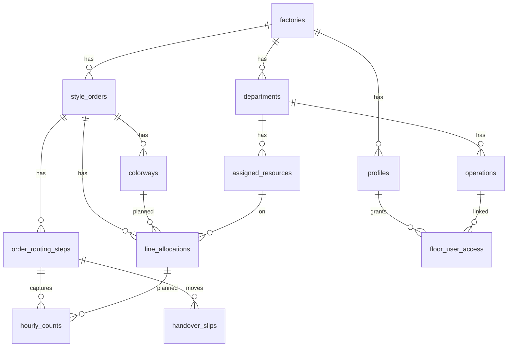

## 23.5 Workflow Legends

| Symbol | Meaning |
|--------|---------|
| Solid arrow | Data flow / sequential step |
| Dashed arrow | Optional path |
| Red highlight | Mandatory gate (handover) |
| Blue highlight | Planning configuration |
| Green highlight | Floor capture |

## 23.6 Future Ideas (Brainstorm)

- Voice-activated piece count for hands-busy operators
- WhatsApp alert for disputed handovers
- Buyer API webhook on OTIF closure
- Carbon footprint per piece (energy IoT)
- Gamification leaderboard per line (efficiency)

## 23.7 FAQ

**Q: Is Prodigi an ERP?**  
A: No. Prodigi is a production MES. It integrates with ERP via exports but does not handle finance, BOM, or procurement.

**Q: Can we self-register a factory?**  
A: No. RBC provisions factories via the secure onboarding process for security.

**Q: Do operators need email accounts?**  
A: No. Floor login uses Factory ID + Employee ID + PIN.

**Q: Can one department run hourly and QC at the same time on the same order?**  
A: No. Output XOR QC — one active capture session at a time.

**Q: Can Sewing capture production if Cutting hasn't sent a handover?**  
A: No. Handover is mandatory — WIP integrity is enforced at the RPC level.

**Q: Does Prodigi work offline on the floor?**  
A: Floor PWA targets offline capture with sync queue; desktop has read-cache only.

**Q: Can one admin manage multiple factories?**  
A: Today one admin per factory session. Company/HQ layer is on the roadmap.

**Q: How is efficiency calculated?**  
A: Actual output × SAM vs. available minutes × headcount from workforce logs.

**Q: What happens when routing is changed after production started?**  
A: Routing save freezes attributes on `order_routing_steps`; historical capture retains original step references.

**Q: Is buyer data visible across factories?**  
A: No. RLS isolates all data by factory_id.

---

## Document End

*This master document is the authoritative source for Prodigi presentation content. When product features change, update the relevant section here first, then regenerate derivative decks.*

**Maintainers:** Product team @ RBC  
**Related docs:** `docs/PLATFORM_ARCHITECTURE.md`, `docs/PRODIGI_OS_ui_flow.md`, `docs/FACTORY_ONBOARDING.md`, `docs/PLAPPS_FLOOR_ACCESS_MODEL.md`
