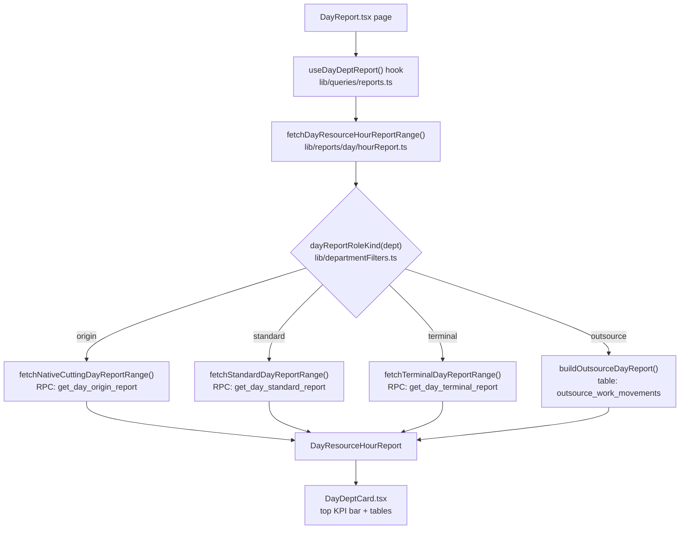
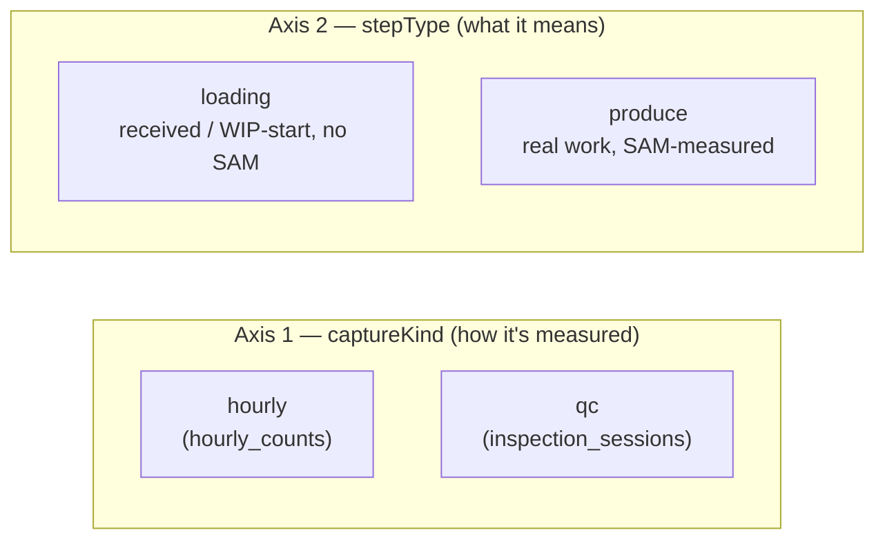
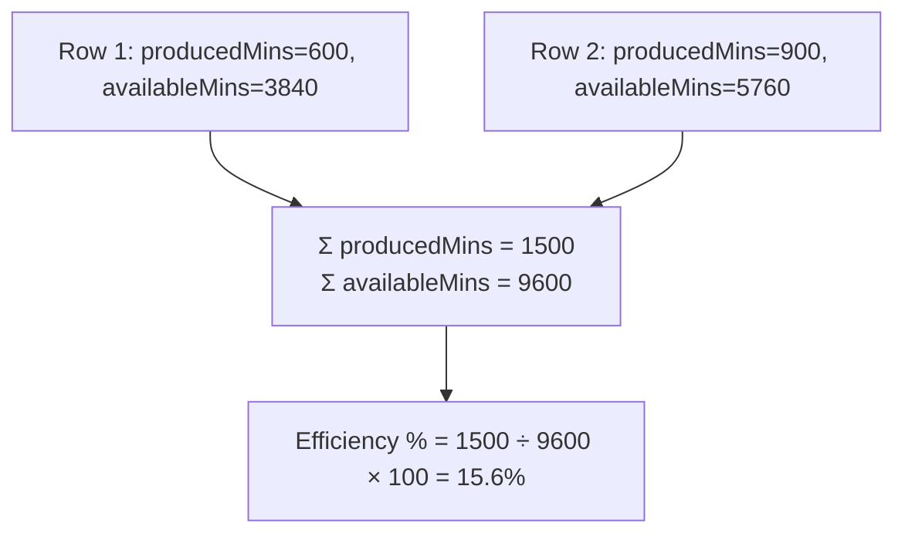
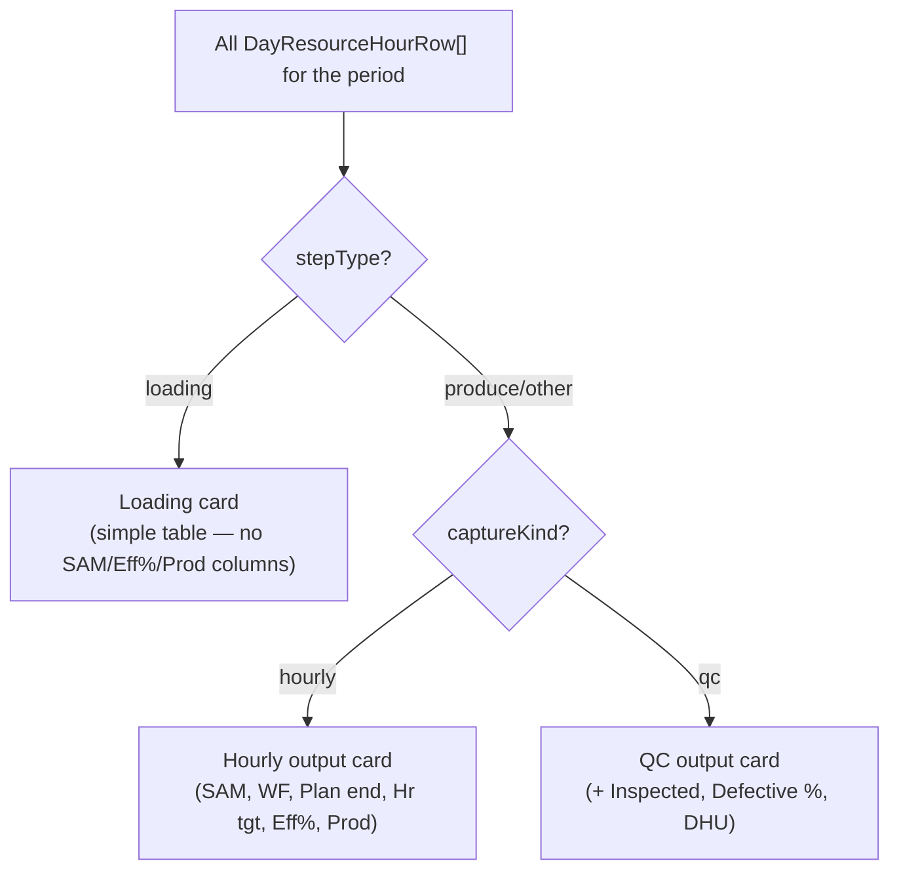

# Day Report — Data Pull & Calculations

This is a from-the-source walkthrough of how the **Day Report** (`pages/reports/DayReport.tsx`) pulls data and computes every number on screen — the top KPI bar, the Hourly output table, the QC output table, and per-operation cards (e.g. "Line Loading"). Every formula below is copied from the actual code, with file:line references, so this doc stays checkable against the source instead of drifting into its own story.

> Companion reading: `/agents/PRODUCTION_FLOW_AGENT.md` for the MES model (Output XOR QC, mandatory handover, optional audit) that this report visualizes.

---

## 1. How a page load turns into numbers



`dayReportRoleKind()` (`lib/departmentFilters.ts:43`) is the single switch that decides which data path a department takes:

| `role` | `planning_mode` | `DayReportRoleKind` | Builder used |
|---|---|---|---|
| `origin` | (any) | `origin` | `fetchNativeCuttingDayReportRange` — cutting sessions |
| `terminal` | (any) | `terminal` | `fetchTerminalDayReportRange` — shipments/dispatch |
| `standard` | `outsource` | `outsource` | `buildOutsourceDayReport` — out-challan/return-challan |
| `standard` | anything else | `standard` | `fetchStandardDayReportRange` — hourly_counts / inspection_sessions |

Each RPC-backed path (`origin` / `standard` / `terminal`) has a **legacy fallback** (`fetchDayResourceHourReport` and friends) that queries the raw tables directly, used only if the RPC is missing on the server (`isPostgrestRpcMissing`). In normal operation the RPC path is what runs.

---

## 2. What each department type actually pulls

| Dept type | Primary rows come from | KPI/target/WIP come from | Handover comes from |
|---|---|---|---|
| **Standard** (Sewing, Finishing, etc.) | RPC `get_day_standard_report` → `hourly_counts` (hourly capture) **or** `inspection_sessions` (QC capture) | RPC/view `get_department_kpis` (`v_department_kpis_by_shift`) | `order_routing_steps` + transaction tables, via `fetchDayDeptHandoverRange` |
| **Origin** (Cutting) | RPC `get_day_origin_report` → `cutting_sessions` | same KPI view, `wip`/`target`/`dhu` only | same |
| **Terminal** (Shipment/QA) | RPC `get_day_terminal_report` → `shipments` | same KPI view | same |
| **Outsource** | `outsource_work_movements` (two-leg: out-challan + return-challan) | same KPI view | derived from the movements themselves |

Every path also pulls, in parallel:
- **`shifts`** — shift definitions, hours, `productive_mins` (drives available minutes).
- **`workforce_logs`** — headcount per resource per day, split by category (operator/helper/etc).
- **`line_allocations`** (`fetchLineAllocPlanRows`) — planned SAM, daily/hourly target, planned end date.
- **`style_orders.sewing_sam`** — per-order fallback SAM when no line allocation matches.
- **`order_routing_steps`** — real `step_type` (`loading` | `produce` | `store` | `outsource`), used to classify rows (see §4).

---

## 3. The row model — `DayResourceHourRow`

Every hourly/QC capture becomes one row (`lib/reports/day/types.ts`), keyed by **date + operation + resource + order + colorway**. This is the atom everything else is built from:

| Field | Meaning |
|---|---|
| `total` | Pieces for this row (passed pieces for QC — see §4). |
| `hours` | `{ "08:00-09:00": 12, "09:00-10:00": 8, ... }` — the per-hour breakdown. |
| `sam` | Planned minutes per piece — from `line_allocations` (by resource+order+colorway) or `style_orders.sewing_sam` fallback. `null` for rows with no SAM data or `stepType === 'loading'`. |
| `producedMins` | `total × sam` — set to `0` for loading rows (see §4). |
| `workforce` | Headcount for this resource, this day (from `workforce_logs`). |
| `resourceAvailableMins` | `workforce × productiveMinsPerWorker` — `0` for loading rows. |
| `efficiencyPct` / `productivity` | Per-row values, computed once per resource per day (see §5). `null` for loading rows. |
| `hourlyTarget` / `plannedEndDate` | From the matching `line_allocations` row (see §5.5). |
| `stepType` | `'loading' \| 'produce' \| ...` — real `order_routing_steps.step_type` for this row's operation. |
| `captureKind` | `'hourly' \| 'qc'` — which capture mode produced this row. |
| `inspectedQty` / `defectiveQty` / `defectivePct` / `dhu` | QC rows only. |

---

## 4. Two independent axes: `captureKind` and `stepType`

A department's rows can vary along **two separate axes**, and the report keeps both distinct so nothing gets silently averaged together:



|  | `captureKind = hourly` | `captureKind = qc` |
|---|---|---|
| `stepType = loading` | **Loading card** — shows loaded qty per hour; no SAM, no Eff%/Prod (see below) | *(rare — loading is not normally QC-captured)* |
| `stepType = produce` | **Hourly output table** — full Eff%/Productivity/SAM math | **QC output table** — same math, computed on *passed* pieces only |

Both splits happen in `buildHourlyOperationSections()` (`lib/reports/day/hourReport.ts:359`): rows are first grouped by **operation** (`operationGroupKeyFromStep`, keyed by `operation_def_id`/`operation_name`), then each operation group is split again into an `hourly` sub-section and a `qc` sub-section. This is why a department whose route has both **"Line Loading"** (`loading`) and **"Sewing Output"** (`produce`) steps renders as **two separate table cards**, not one mixed table — and why an operation that moved from QC capture to hourly capture over time still gets two cleanly separated tables instead of one row set with mismatched columns.

**Why `loading` is special:** per `docs/STEP_TYPES_CAPACITY_SHIFTS.md`, a `loading` step is a *receiving / WIP-start acknowledgement* — pieces arrive at a line and get logged, but no SAM-measured work has happened yet. So loading rows:
- Never get a SAM assigned, even via the per-order fallback (`enrichDayResourceRows`, `lib/reports/day/deptMetrics.pure.ts:236`).
- Contribute `0` to `producedMins` and `resourceAvailableMins`.
- Show `—` for Efficiency % / Productivity, both per-row and in their card's footer.
- Are **excluded** from the department's headline Output/Efficiency/Productivity/Workforce KPI bar (`fetchStandardDayReportRange`, `lib/reports/day/hourReport.ts`, filters `rows` to `productionRows = rows.filter(r => r.stepType !== 'loading')` before computing `kpi`).
- Still show up in their **own labeled card** (e.g. "Line Loading") with real loaded-qty totals and workforce — they're just not treated as *production*.

---

## 5. The calculations

### 5.1 SAM and produced minutes (per row)

```
sam           = line_allocations match (order+colorway+resource) → allocationSamValue()
                 ?? style_orders.sewing_sam for that order
                 ?? 0
producedMins  = row.total × sam        (0 if stepType === 'loading')
```

`allocRowKey(orderId, colorwayId, resourceId)` is the lookup key against `line_allocations`; if nothing matches, the order's flat `sewing_sam` is used. (`deptMetrics.pure.ts:236-260`)

### 5.2 Available minutes (per resource, per day)

```
resourceAvailableMins = workforce × productiveMinsPerWorker
```

`productiveMinsPerWorker` comes from the regular shift's `productive_mins` (falls back to `480` if unset). Counted **once per resource per day** — not per row — so a resource logging output across 3 orders in one shift doesn't triple its available minutes.

### 5.3 Efficiency % and Productivity — "sum first, divide once"

This is the rule the whole report follows, at every level (per-row, per-section, per-department, single day or a date range):

> **Sum the numerator across every row/day. Sum the denominator across every row/day. Divide once, at the end.**
> Never average a per-row or per-day *percentage* — that silently distorts the result whenever rows/days have different weights.

```
Efficiency %  =  Σ producedMins  ÷  Σ availableMins   × 100
Productivity  =  Σ output        ÷  Σ workforce-person-days
```

Where `workforce-person-days` = for every **distinct (resource, day)** pair, that resource's headcount that day, summed. (Not summed per-row — a resource working 3 shifts the same day only counts once for that day.)

`computeDayDeptMetricsFromRows()` (`deptMetrics.pure.ts:318`) is the single function that does this, used for:
- The **top KPI bar** (via `report.kpi.efficiency` / `report.kpi.productivity`, computed server-side over every row for the period, excluding `loading` rows).
- Each **table/card's own footer row** (computed over just that section's rows).



**Worked example — why "sum first" matters:**

| Day | Output | Workforce |
|---|---|---|
| Day 1 | 50 | 5 |
| Day 2 | 50 | 5 |
| Day 3 | 50 | 5 |

- ❌ Wrong (average the daily ratio): (10 + 10 + 10) / 3 = **10** — coincidentally right here, but breaks the moment headcount varies day to day.
- ✅ Correct (ratio of sums): 150 output ÷ 15 person-days = **10** — stays a stable "10 pieces per worker" rate no matter how many days are in the range, because both sides scale together.

This is directly tested in `deptMetrics.pure.test.ts` ("keeps productivity a stable per-worker rate across a multi-day range with steady headcount").

**Where the client used to get this wrong:** `DayDeptCard.tsx`'s top KPI bar used to recompute `computeDayDeptMetricsFromRows(report.rows)` **client-side**, over *every* row including `loading` rows (which have `total > 0` but, correctly, `producedMins = 0`). That diluted the ratio — inflating the denominator-side row count without contributing real produced minutes. **Fixed**: the top bar now reads `report.kpi.efficiency` / `report.kpi.productivity` (the server-side, loading-excluded computation) directly, falling back to a client recompute — with `loading` rows filtered out — only if the server value is unexpectedly absent.

### 5.4 Workforce KPI — average daily headcount, not a sum

> "For a day, sum every resource's headcount across all styles/lines that day. For a range, average that daily sum across the days present."

```
workforcePersonDays = Σ (per distinct resource-day) headcount
dayCount             = number of distinct days with any data
Workforce KPI        = workforcePersonDays ÷ dayCount
```

So a single-day report just shows that day's total headcount; a 7-day report shows the *average* daily headcount, not 7× the total. (`computeDayDeptMetricsFromRows`, `deptMetrics.pure.ts:339-341`)

For **origin/cutting** departments, cutting sessions often don't reliably carry a `resource_id` that matches `workforce_logs`, so workforce is instead computed **directly from the logs**, independent of rows: `averageDailyHeadcountFromLogs()` (`deptMetrics.pure.ts:77`) — same "sum per day, then average across days" logic, just sourced straight from `workforce_logs` rather than via row → resource matching.

### 5.5 Hourly Target and Planned End

Both come from the best-matching `line_allocations` row for (order, colorway, resource, date, department) — scored by exact line/colorway/date-window match (`scoreAllocationMatch`, `deptMetrics.pure.ts:118`):

```
dailyTarget = line_allocations.daily_target  ??  ceil(qty ÷ working_days)
hourlyTarget = line_allocations.hourly_target  ??  dailyTarget ÷ regular_shift_hours
plannedEndDate = line_allocations.end_date
```

Displayed rounded to a whole number (`formatHrTarget`, `DayDeptCard.tsx`) — the underlying value can be fractional, only the display is rounded.

### 5.6 QC metrics — Pass %, Defective %, DHU, and yes, Efficiency/Productivity too

For a QC-captured row, `total` (and therefore all the produced-minutes/efficiency/productivity math above) is **passed pieces only** — first-time pass **and** rework pass, never the raw inspected count. This comes straight from the RPC: `qty = COALESCE(qs.passed, 0)`. So:

```
passed      = row.total                       (already first-pass + rework-pass)
inspected   = row.inspectedQty
defective   = inspected − passed
defectivePct = defective ÷ inspected × 100
dhu          = defectivePct   (no distinct per-defect count is captured —
                                 a defective piece counts as exactly one defect
                                 in this app's model, so DHU ≡ defective %)
passPct      = passed ÷ inspected × 100
```

Efficiency %/Productivity for QC rows use the exact same formulas as §5.3 — `sam × passed` for produced minutes — because `enrichDayResourceRows` runs over **every** row regardless of `captureKind`. The QC table was extended to show SAM, Plan end, Eff %, and Productivity columns for this reason — the data was already being computed, just not displayed.

Department-level `kpi.passPct` / `kpi.defectivePct` / `kpi.dhu` are separate, period-level aggregates:

```
kpi.passPct      = Σ passed ÷ Σ inspected × 100
kpi.defectivePct = (Σ inspected − Σ passed) ÷ Σ inspected × 100     (= 100 − passPct)
kpi.dhu          = weighted average of per-day dhu from the KPI view, weighted by daily_output
```

### 5.7 WIP — sourced from handover, **not** from hourly/loading counts

WIP is deliberately **not** derived from summing hourly/loading counts — it's meant to come from the mandatory handover ledger (received vs sent), which is the actual "WIP integrity spine" per `AGENTS.md`. In the day-report code, `aggregateDeptDayKpi()` (`deptMetrics.pure.ts:353`) takes the **latest-day snapshot** of `wip_qty` per order from the department KPI rows (not summed across days — WIP is a point-in-time balance, not a flow quantity):

```
wip = Σ (over each order's latest log_date only) row.wip_qty
```

> **⚠️ Known issue found while writing this doc:** the KPI rows feeding this (`fetchDepartmentKpis` → `v_department_kpis_by_shift` → `aggregateShiftRowsToDaily()`, `lib/reports/kpiAndProgress.ts:249`) currently **hardcode `wip_qty: 0`** for every row — the view's column list doesn't expose a `wip_qty` at all, so the day-report's WIP KPI is effectively always `0` via this path. (A working WIP formula does exist elsewhere in the schema — `order_dept_progress_rows()` computes `GREATEST(GREATEST(qty_received, qty_produced) − qty_sent, 0)` — but the Day Report's KPI pull doesn't currently go through it.) This wasn't introduced by anything in this session; it looks pre-existing. Flagging it here rather than fixing it blind, since it needs a decision on where WIP should actually be sourced from for this report.

---

## 6. How rows become the tables you see

The split is explicit and two-level — `stepType` is the primary split, `captureKind` is the secondary split *within* production:



Three possible cards, each its own collapsible container in `DayDeptCard.tsx`, each with its **own** `useMemo` computing its row set and its own `render*Table` function (different column sets — a Loading row's SAM/Eff%/Productivity are always `null`, so that table doesn't render those columns at all, instead of showing a wall of `—`):

| Card | Shown when | Row filter |
|---|---|---|
| **Loading** | `stepType === 'loading'` rows exist | `loadingVisibleRows` |
| **Hourly output** | always (primary card) | `mainVisibleRows` = `captureKind !== 'qc' && stepType !== 'loading'` |
| **QC output** | QC rows exist | `qcVisibleRows` = `captureKind === 'qc' && stepType !== 'loading'` |

Two ways this split is produced, depending on how many operations the department's route has:

- **Multiple operations** (e.g. Line Loading + Sewing Output, or Block Cut + Fixed Cut): rows render as one section **per operation** (`operationSections`, built by `buildHourlyOperationSections`, `lib/reports/day/hourReport.ts:359`). Each operation group carries its own `stepType` (from `order_routing_steps.step_type`) and is further split into an `hourly` sub-section and a `qc` sub-section if that operation's capture mode has moved between the two. The UI then groups these operation sections into the three cards above by `stepType`/`captureKind`.
- **Only one operation total**: `operationSections` is `undefined`, and rows render from the flatter `shiftSections` / `qcShiftSections` instead (one table per shift). In the rare case that lone operation *is* a loading step, `DayDeptCard` detects it (`fallbackIsLoadingOnly`) and still routes it to the Loading card rather than folding it into "Hourly output".

This needs `order_routing_steps.step_type` to be resolved correctly per row/operation-group — see §4.

Column widths on all three tables are fixed (`table-fixed` + an explicit `<colgroup>`, `DayDeptCard.tsx`) so a long style/buyer name truncates instead of reflowing every other column.

---

## 7. File map

| File | Responsibility |
|---|---|
| `pages/reports/DayReport.tsx` | Page shell — filters, date range, CSV/Excel export, wires props into `DayDeptCard`. |
| `components/reports/DayDeptCard.tsx` | Top KPI bar, Hourly/QC table rendering, per-section footers. |
| `lib/reports/day/hourReport.ts` | Per-department-type report builders (RPC + legacy fallback), operation/shift section splitting. |
| `lib/reports/day/deptMetrics.pure.ts` | All the pure math: SAM enrichment, efficiency/productivity, workforce averaging, WIP/target aggregation. **Has full unit test coverage** (`deptMetrics.pure.test.ts`) — this is the file to read (and test) first when a number looks wrong. |
| `lib/reports/day/standardTerminalRpc.ts`, `cuttingSessionsRpc.ts` | Typed wrappers around the `get_day_*_report` RPCs. |
| `lib/reports/day/types.ts` | Shape of `DayResourceHourRow` / `DayResourceHourReport` — the contract between data-layer and UI. |
| `lib/reports/kpiAndProgress.ts` | `get_department_kpis` fetch + shift→day aggregation (target, DHU, WIP). |
| `lib/departmentFilters.ts` | `dayReportRoleKind()` — the origin/standard/terminal/outsource classification. |

---

## 8. Quick reference — where to look when a number is wrong

| Symptom | Likely place to look |
|---|---|
| Wrong Output total | `kpi.output` computation in the relevant `fetch*DayReportRange` function — check whether `loading` rows are (correctly) excluded. |
| Wrong Efficiency %/Productivity | `computeDayDeptMetricsFromRows` — confirm it's being fed the right row set (excluding `loading`), and that the UI is reading `report.kpi.*`, not a stale client recompute. |
| Wrong Workforce | For standard depts: row-based dedup in `computeDayDeptMetricsFromRows`. For origin/cutting: `averageDailyHeadcountFromLogs`. |
| Wrong SAM / target / planned end | `line_allocations` matching in `findAllocationForDayRow` / `applyAllocationPlanToDayRows` — check the allocation actually covers that resource/order/date window. |
| A department shows one mixed table instead of separate operation cards | `buildHourlyOperationSections` — confirm `order_routing_steps.step_type` is resolving (via `fetchRoutingStepsForDepartment`), not falling back to a synthetic step with no `step_type`. |
| WIP looks wrong / always 0 | See §5.7 — known gap in `v_department_kpis_by_shift` / `aggregateShiftRowsToDaily`. |
