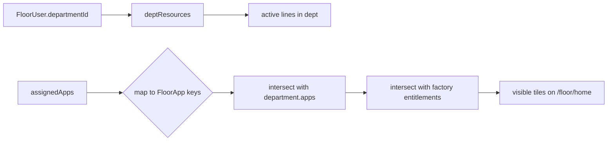
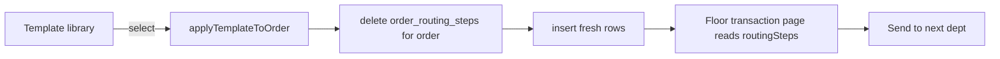
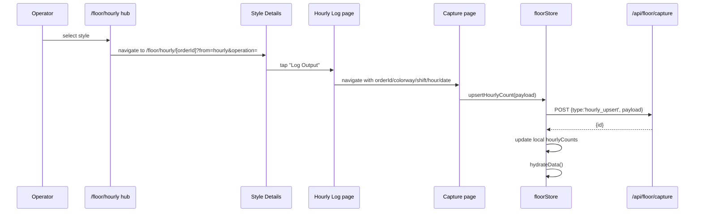
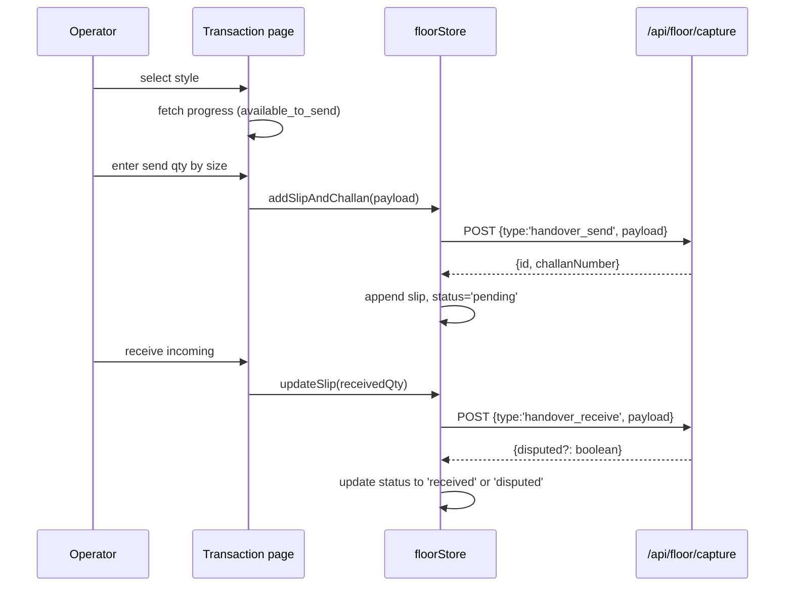
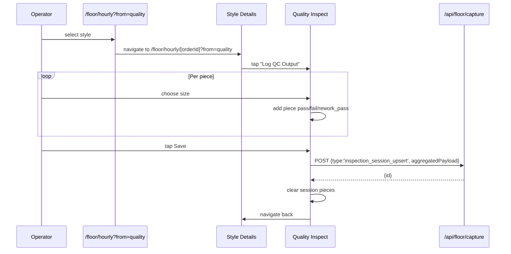
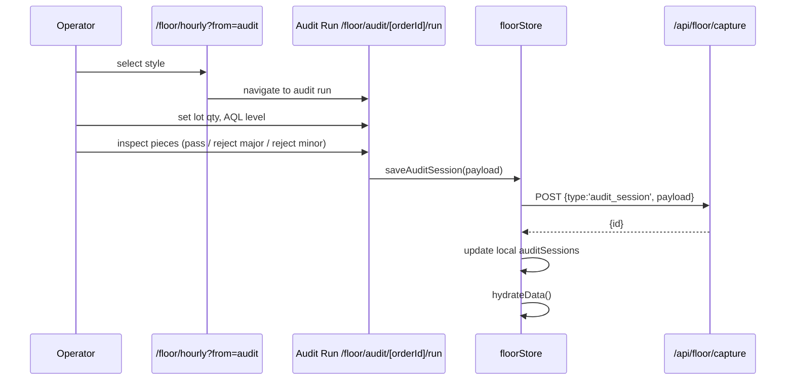
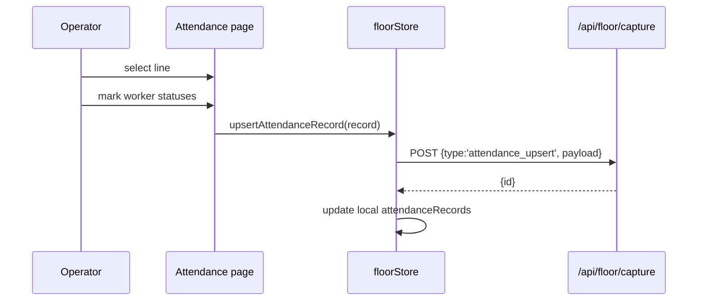

# PRODIGI OS — Front-End UI Flow & Logic

> Single source of truth for how the PRODIGI OS front-end actually works, based on the code in this repo.
> 
> - Main web app: Vite + React + TypeScript + TailwindCSS, hash-based SPA.
> - Floor PWA: Next.js app in `plapps/`, cookie-based PIN/email login.
> - All route paths and payload keys are quoted directly from the code. Anything not found is marked explicitly.

---

## Screen Inventory

| Screen | Route / Path | Source File | Type | Primary Payload / RPC Keys |
|--------|--------------|-------------|------|----------------------------|
| Dashboard | `#/dashboard` | `pages/Dashboard.tsx` | Main app | Read-only summary cards |
| Create Order | `#/create-order` | `pages/production/CreateOrderMaster.tsx` | Main app | `saveStyleOrderAtomic` → `save_style_order` |
| Style Details | `#/style-details/:id` | `pages/production/StyleDetails.tsx` | Main app | Read-only |
| Style Color Details | `#/style-color-details/:id/:colorId` | `pages/production/StyleColorDetails.tsx` | Main app | Read-only |
| Planning Board | `#/line-assignment` | `pages/planning/PlanningOrderList.tsx` | Main app | Read-only list |
| Production Planning | `#/planning-detail` | `pages/planning/ProductionPlanning.tsx` | Main app | `saveLinePlanAtomic` → `save_line_plan` |
| Dept. Schedule | `#/dept-schedule` | `pages/planning/DepartmentSchedule.tsx` | Main app | Read-only Gantt |
| Status Tracker | `#/status-tracker` | `pages/production/StatusTracker.tsx` | Main app | Read-only |
| Order Completion | `#/production/order-completion` | `pages/production/OrderCompletion.tsx` | Main app | Closure / reconciliation actions |
| Transaction Report | `#/planning/transaction-report` | `pages/planning/TransactionReport.tsx` | Main app | Read-only |
| Day Report | `#/reports/day` | `pages/reports/DayReport.tsx` | Main app | Read-only |
| Style Report | `#/reports/style` | `pages/reports/StyleReport.tsx` | Main app | Read-only |
| Work Centers | `#/work-centers` | `pages/system/WorkCenters.tsx` | Main app | Buyers / Departments / Process Flows (tabbed) |
| User Management | `#/user-management` | `pages/system/UserManagement.tsx` | Main app | Admin user CRUD |
| Workforce | `#/workforce` | `pages/Workforce.tsx` | Main app | Master worker roster |
| Settings | `#/settings` | `pages/Settings.tsx` | Main app | Shifts and Support Dropdowns |
| Floor Login | `/floor/login` | `plapps/app/login/page.tsx` | Floor PWA | `email`, `pin` |
| Floor Home | `/floor/home` | `plapps/app/floor/home/page.tsx` | Floor PWA | Read-only tiles |
| Floor Profile | `/floor/profile` | `plapps/app/floor/profile/page.tsx` | Floor PWA | Preferred resources toggle |
| Hourly Style Selection | `/floor/hourly` | `plapps/app/floor/hourly/page.tsx` | Floor PWA | Read-only |
| Style Details | `/floor/hourly/[orderId]` | `plapps/app/floor/hourly/[orderId]/page.tsx` | Floor PWA | Read-only progress |
| Hourly Log | `/floor/hourly/[orderId]/log` | `plapps/app/floor/hourly/[orderId]/log/page.tsx` | Floor PWA | Read-only log |
| Hourly Capture | `/floor/hourly/[orderId]/capture` | `plapps/app/floor/hourly/[orderId]/capture/page.tsx` | Floor PWA | **OPERATIONAL** — `hourly_upsert` |
| Handover / Transaction | `/floor/transaction` | `plapps/app/floor/transaction/page.tsx` | Floor PWA | **OPERATIONAL** — `handover_send`, `handover_receive`, `handover_amend` |
| QC Inspection | `/floor/hourly?from=quality` → `/floor/quality/inspect?order=&colorway=` | `plapps/app/floor/quality/inspect/page.tsx` | Floor PWA | **OPERATIONAL** — `inspection_session_upsert` |
| QC History | `/floor/quality/history?order=&colorway=` | `plapps/app/floor/quality/history/page.tsx` | Floor PWA | Read-only |
| QC Analytics | `/floor/quality/history?order=&colorway=&tab=analytics` | `plapps/app/floor/quality/history/page.tsx` | Floor PWA | Read-only |
| Hourly Output History | `/floor/hourly/[orderId]/history?from=&colorway=` | `plapps/app/floor/hourly/[orderId]/history/page.tsx` | Floor PWA | Read-only |
| Audit Session | `/floor/audit/[orderId]/run` | `plapps/app/floor/audit/[orderId]/run/page.tsx` | Floor PWA | **DEPARTMENTAL** — `audit_session` |
| Workforce Log | `/floor/workforce/[resourceId]/log` | `plapps/app/floor/workforce/[resourceId]/log/page.tsx` | Floor PWA | **OPERATIONAL** — `workforce_upsert` |
| Attendance | `/floor/attendance` | `plapps/app/floor/attendance/page.tsx` | Floor PWA | **DEPARTMENTAL** — `attendance_upsert` |
| Shipment / QA | `/floor/shipment/styles?mode=ship` | `plapps/app/floor/shipment/styles/page.tsx` | Floor PWA | **OPERATIONAL** — `shipment_log`, `shipment_rejection_log`, `colorway_ship_close` |
| Shipment Audit | `/floor/shipment/styles?mode=audit` | `plapps/app/floor/shipment/styles/page.tsx` | Floor PWA | **DEPARTMENTAL** — `shipment_audit_session` |
| Shipment Reject Log | `/floor/rejection` → `/floor/shipment/styles?mode=ship` | `plapps/app/floor/rejection/page.tsx` | Floor PWA | **OPERATIONAL** — `shipment_rejection_log` |

> **Type definitions**
> - **OPERATIONAL** — directly logs production output, WIP movement, or piece-level inspection.
> - **DEPARTMENTAL** — logs labor/attendance/audit data used for department control but not counted as produced WIP.

---

## 1. App Map & Navigation

### 1.1 Main Web App

Entry point: `pages/Login.tsx` → `supabase.auth.signInWithPassword` → `fetchMyProfile` (RPC `get_my_profile`) → `desktopAccessError` gate → `applyAuthenticatedProfile` → navigates to `RoutePath.DASHBOARD` (`#/dashboard`).

Desktop login is restricted to `admin` or `superadmin` roles (`DESKTOP_LOGIN_ROLES` in `lib/authSession.ts`). If the user's role is not in that set, the login shows: "This account is for the floor mobile app. Sign in there with email and PIN."

Route switch is in `App.tsx`. It uses `currentRoute` from `navigationStore` and lazy-loads pages. Notably, `StyleDetails` and `StyleColorDetails` are imported but have no `case` in the switch, so those routes fall through to `Dashboard`.

```
RoutePath values (types/shared.ts)
- #/dashboard
- #/create-order
- #/style-details/:id
- #/style-color-details/:id/:colorId
- #/line-assignment
- #/planning-detail
- #/dept-schedule
- #/status-tracker
- #/admin
- #/settings
- #/work-centers
- #/work-centers/departments
- #/work-centers/buyers
- #/work-centers/process-flows
- #/user-management
- #/workforce
- #/reports
- #/reports/day
- #/reports/style
- #/production/order-completion
- #/planning/transaction-report
```

Sidebar navigation is in `components/Layout.tsx`. Menu groups are hardcoded:
- **Main** — Dashboard
- **Production** — Create Order, Status Tracker, Order Completion
- **Planning** — Planning Board, Dept. Schedule, Transaction Report
- **Reports** — Day Report, Style Report
- **Work Centers** — Work Centers
- **Admin** — User Management
- **System** — Settings

The `Layout` component enforces unsaved-changes protection:
- `beforeunload` blocker.
- `hashchange` blocker.
- `requestNavigate` checks `isUnsaved` and shows the global modal.
- `confirmSaveAndLeave` calls `pendingSaveAction` before navigating.

Main app stores (Zustand):
- `navigationStore` — current route, route params, unsaved state, user profile, factory id
- `dataStore` — orders, allocations, resources, buyers, production data
- `settingsStore` — shifts, departments, process flows, support dropdowns, entitlements
- `notificationStore` — toast notifications

```mermaid
flowchart LR
    A[Login] --> B{desktopAccessError?}
    B -->|yes| A[show error]
    B -->|no| C[Layout + Sidebar]
    C --> D[Route switch in App.tsx]
    D --> E[Dashboard | Create Order | Planning | Reports | Work Centers | Settings]
```

### 1.2 Floor PWA

Entry point: `/floor/login` (`plapps/app/login/page.tsx`).
Login calls `POST /api/floor/login` with `{ email, pin }`. On success, server sets a signed `pl-floor-session` cookie and returns `FloorUser`.

`plapps/app/floor/page.tsx` redirects to `/floor/home`.

Bottom nav is in `plapps/app/floor/layout.tsx`:
- Home icon → `/floor/home`
- Profile icon → `/floor/profile`
- Hidden on immersive capture screens (quality inspect, audit run, etc.).

Floor stores (Zustand):
- `authStore` — `currentUser`, `hydrateData`, `login`
- `masterStore` — departments, resources, shifts, process flows, routing steps, allocations
- `orderStore` — orders and colorways
- `floorStore` — hourly counts, slips, workforce logs, attendance, audit/shipment sessions
- `prefsStore` — session resource, preferred resources, completion flags
- `shiftStore` — active shift and hour slot

```mermaid
flowchart LR
    A[/floor/login] -->|POST /api/floor/login| B[/floor/home]
    B --> C[App tiles]
    C --> D[Hourly | Handover | QC | Audit | Workforce | Attendance | Shipment]
    D --> E[Capture screens]
    B --> F[/floor/profile]
```

---

## 2. Department Logic

### 2.1 Main Web App

Departments are managed in `pages/system/WorkCenterDepartments.tsx` (Work Centers tab). Each department has `name`, `sequence`, `apps`, `workerRoles`, `operationActivities`, `isOutsourced`.

A user profile (`pages/system/UserManagement.tsx`) has:
- `departmentId`
- `assignedApps`
- `role`

`desktopAccessError` (`lib/authSession.ts`) blocks desktop access if the user's profile lacks desktop entitlements.

### 2.2 Floor PWA

The floor user's department is resolved from `FloorUser.departmentId` returned by the login API.

Visible apps are computed in `lib/floorAppMap.ts`:

```typescript
export function computeVisibleApps(
  userFloorApps: FloorApp[],
  deptApps: string[] | undefined | null,
  entitlements?: FactoryEntitlements | null,
): FloorApp[] { ... }
```

Intersection rule:
1. User's assigned apps are mapped to `FloorApp` keys using `DEPT_APP_TO_FLOOR`:
   - `hourly` → `production`
   - `transaction` → `production`
   - `qc_log` → `production`
   - `workforce_log` → `workforce`
   - `attendance` → `attendance`
   - `audit` → `audit`
   - `shipment_log` → `shipment`
   - `final_rejection_log` → `rejection`
2. The department's `apps` array must contain the original DB key.
3. Factory entitlements (`factoryEntitlementsFromDb`) act as a ceiling:
   - `production: ['hourly', 'qc_log']`
   - `transaction: ['transaction']`
   - `workforce: ['workforce_log', 'attendance']`
   - `audit: ['audit']`
   - `shipment: ['shipment_log', 'final_rejection_log']`
4. Factory-wide apps (`shipment`, `rejection`) bypass the department check and are gated only by `entitlements.shipment`.
5. `hourly`, `transaction`, `qc_log` all map to the same `production` tile; the home page deduplicates them into one tile.

Department-specific resources (lines) are filtered by `deptResources(resources, user.departmentId)` and only those with `status === 'active'` are shown.



---

## 3. Process Flow & Routing

### 3.1 Concepts

Process flow templates are created in Work Centers → Process Flows (`pages/system/WorkCenterProcessFlows.tsx`).

A template consists of `ProcessFlowStep`s:

```typescript
interface ProcessFlowStep {
  id?: string;
  flow_step: number;       // 1-based sequence
  dept_id: string;         // department ID
  dept_name: string;       // department name
  step_label: string;      // operation label (must match an activity on the department)
  step_type: 'produce' | 'inspect' | 'outsource';
  capture_app: 'transaction' | 'hourly' | 'qc_log' | 'audit' | 'workforce_log' | 'attendance';
}
```

### 3.2 Order Routing

At planning time, a planner selects a routing template in either:
- `components/planning/ColorwayRoutingPanel.tsx` (deprecated clone path, now calls `cloneTemplateForOrder` which is an alias to `applyTemplateToOrder`)
- `components/planning/ColorwayRoutingTable.tsx` (direct `applyTemplateToOrder`)

Both write flat rows to `order_routing_steps`:

```typescript
{
  id: uuid,
  factory_id,
  order_id,
  seq: flow_step,
  dept_id,
  dept_name,
  step_label,
  step_type,
  capture_app,
  source_template_id,
}
```

Routing is now order-level, not colorway-level (per pending change notes). `colorways.processFlow` is deprecated.

The floor PWA uses `masterStore.routingSteps` to determine the next department (`getNextDept`) and next operation (`getNextOperation`) for handover sends.



---

## 4. Planning

### 4.1 Order Creation

Route: `#/create-order` (`pages/production/CreateOrderMaster.tsx`).

Key fields:
- `styleName`, `styleRef`, `poNumber` (required)
- `selectedBuyer` → `buyerId`, `buyer`
- `orderDate`, `jobCardDate`
- `garmentType`, `washType`, `merchantName`, `season`
- `priority` (`normal` | ...)
- `sewingSam` (minutes, stored as `sewingSam`)
- `colorways[]` (created via `ColorQtyWorkspace` / `ColorTemplatePanel`)
- `sizeGroupSelection` (dropdown or `SIZE_GROUP_SNAPSHOT`)
- `cuttingAllowance` (default 2%)
- `applyExtraAllowance` (if buyer has `overShipmentAllowance`)
- `shipmentPlan` (`OrderShipmentPlan` with `ShipmentPlanLine[]`)
- `remarks`

Calculated fields:
- `orderQty` = sum of `order_qty` per colorway
- `adjQty` = sum of `adj_qty` (order qty + cutting allowance + optional extra allowance)
- `sizeLabels` = `formatSizeLabels(displaySizes)`
- `sizeGroupName` = selected template group name

Save flow:
1. `handleConfirmOrder` calls `constructOrderObject()`.
2. `dataStore.addOrder(order)` or `dataStore.updateOrder(id, order)`.
3. Both call `saveStyleOrderAtomic(factoryId, order, orderId)` in `lib/saveStyleOrder.ts`.
4. That RPC calls `save_style_order` with the full order object.
5. On success, navigates to `RoutePath.STYLE_DETAILS` or offers to go to planning.

Order shipment plan line shape:

```typescript
interface ShipmentPlanLine {
  id: string;
  shipmentDate: string;
  shipMode: string;
  shipmentType: string;
  colorwayId: string;
  sizes: Record<string, number>;
  destinationCountry?: string;
  status?: 'planned' | 'replanned';
  notes?: string;
  _dateChangeReason?: string; // UI transient
}
```

### 4.2 Production Planning

Route: `#/planning-detail` (`pages/planning/ProductionPlanning.tsx`).

Context: an order is selected and a color is selected. The page shows:
- Top order-level table (always shows overall qtys, unchanged per color)
- Color section with routing
- Right side: per-color allocation rows on a Gantt timeline

Planning row fields (`pages/planning/types.ts`):
- `resourceId` (line id)
- `startDate`, `endDate`
- `plannedQty`
- `dailyTarget` (overridable)
- `dailyTargetOverridden: boolean`
- `sam`
- `workforce`
- `flowStepId`
- `id` (temp or persisted)

Save flow:
1. `handleSavePlan` collects all dirty color buffers.
2. `buildColorwayPlanPayloads` in `lib/buildLinePlanPayload.ts` converts rows into `ColorwayPlanPayload[]`:

```typescript
interface LinePlanAllocationPayload {
  id: string;
  line_id: string;
  department_id: string | null;
  flow_step_id?: string | null;
  start_date: string;
  end_date: string;
  qty: number;
  daily_target: number;
  hourly_target: number | null;
  sam: number | null;
  kpi_inputs: {
    workforce: number;
    sam: number;
    efficiency: number;
    productivity: number;
  };
  style_name: string;
  po_number: string;
  colorway: string;
  completed_is_true: boolean;
}

interface ColorwayPlanPayload {
  colorway_id: string;
  allocations: LinePlanAllocationPayload[];
}
```

3. `saveLinePlanAtomic` calls `save_line_plan` RPC with:
   - `p_factory_id`
   - `p_order_id`
   - `p_colorway_plans`

Approval gates: none found in the front-end code for planning submission; the page is saved directly when the user clicks Save Plan.

---

## 5. Capture Flows

All floor captures go through `POST /api/floor/capture` with `{ type, payload }`, which calls `floor_capture(p_factory_id, p_user_id, p_type, p_payload)` or one of the specialized `floor_capture_*` RPCs.

Store: `lib/stores/floorStore.ts`.

### 5.1 Hourly Output

**Style selection hub**: `/floor/hourly` (also used for `from=quality`, `from=audit`, `from=transaction`)
**Source hub**: `plapps/app/floor/hourly/page.tsx`
**Style details**: `/floor/hourly/[orderId]`
**Source details**: `plapps/app/floor/hourly/[orderId]/page.tsx`
**Capture screen**: `/floor/hourly/[orderId]/capture`
**Source capture**: `plapps/app/floor/hourly/[orderId]/capture/page.tsx`
**Type**: **OPERATIONAL**

The `/floor/hourly` page is a shared style selection hub. It reads `from` from query params and shows the corresponding context:
- `from=hourly` (default) — list styles for hourly output.
- `from=quality` — list styles for QC inspection (same styles as hourly).
- `from=audit` — list styles for AQL audit.
- `from=transaction` — list styles for handover; filters to the department's exit operation.

Flow:
1. User selects a style from the hub.
2. Style details page (`/floor/hourly/[orderId]`) shows progress and a "Log Output" button.
3. `StyleActions` component renders either:
   - "Log Output" → `/floor/hourly/[orderId]/log?date=&colorway=&from=&operation=`
   - "Log QC Output" → `/floor/quality/inspect?order=&colorway=&operation=`
4. Log page shows hour slots by shift.
5. Tapping a slot opens the capture page.

Inputs:
- `orderId` (route param)
- `colorwayId` (URL param, defaults to first colorway)
- `shiftId` (URL param)
- `hourSlot` (URL param)
- `logDate` (URL param, defaults to today)
- `operationId` (URL param, used to distinguish operations in multi-op flows)
- Size-wise output table (`SizeSplitTable`)

Validation:
- Save disabled if `captureTotal <= 0`.
- Per-size input is capped by `captureBalanceBySize` (planned - already produced excluding current slot).
- OT shift requires workforce logged for that shift/date.

Payload sent to `upsertHourlyCount`:

```typescript
{
  orderId: string;
  colorwayId: string | null;
  departmentId: string;
  operationId: string | null;
  shiftId: string;
  hourSlot: string;
  logDate: string;
  count: number;
  countBySize: Record<string, number>;
  loggedAt: string;
  resourceId: string | null;
}
```

RPC type: `hourly_upsert`.



### 5.2 Transaction / Handover

**Screen**: `/floor/transaction`
**Source**: `plapps/app/floor/transaction/page.tsx`
**Type**: **OPERATIONAL**

Flow steps (`Step` union):
- `order` — select a style
- `action` — choose Send, Receive, History, Slip Detail, or Mark Handover Complete
- `send` — send to next department
- `receive` / `receive-qty` — receive incoming slip
- `history` — slip history
- `slip-detail` — view a single slip
- `dispute-detail` — view a disputed slip
- `amend` — amend / accept a disputed slip

If `?order=` is present, the page jumps straight to `action`. If `?step=history` is present, it jumps straight to history.

#### 5.2.1 Send

Inputs:
- `selectedOrder`
- `myDeptId` (from user)
- `colorwayId`
- `operationId` (selected current operation)
- `sendQty` and `sendQtyBySize`
- `notes`

Validation:
- `operationId` must be selected.
- `sendQty > 0`
- `sendQty <= maxSendQty` where `maxSendQty = available_to_send` from `get_order_dept_progress` RPC.
- `availableToSendBySize` computed from `produced_qty_by_size - sent_qty_by_size`.

Payload sent to `addSlipAndChallan`:

```typescript
{
  orderId: string;
  colorwayId: string | null;
  fromDepartmentId: string;
  toDepartmentId: string;
  operationId: string | null;
  toOperationId: string | null;
  sentQty: number;
  qtyBySize: Record<string, number>;
  sentBy: string;     // user.id — page passes it, store action drops it
  sentAt: string;     // ISO timestamp
  notes: string | null;
}
```

RPC type: `handover_send` (payload does not include `sentBy`).

#### 5.2.2 Receive

Inputs:
- `selectedSlip` (pending slip for my department)
- `receiveQty`, `receiveQtyBySize`
- `notes`

Validation:
- `receiveQty > 0`
- `receiveQty <= selectedSlip.sentQty`
- Mismatch notes required if `receiveQty !== sentQty`.

Payload sent to `updateSlip`:

```typescript
{
  receivedQty: number;
  receivedQtyBySize: Record<string, number>;
  receivedBy: string;     // page passes it, store action drops it
  receivedAt: string;     // page passes it, store action drops it
  receivedNotes: string | null;
  status: 'received';
}
```

RPC type: `handover_receive` (payload does not include `receivedBy` or `receivedAt`; server sets them).

The server returns `disputed: true` if the received qty is short; the local slip status is set to `'disputed'`.

#### 5.2.3 Amend / Dispute Resolution

Two `handover_amend` calls:
1. Accept received count:
   ```typescript
   { slipId, acceptReceived: true }
   ```
2. Amend sizes:
   ```typescript
   { slipId, amendedSizes: Record<string, number> }
   ```



### 5.3 Quality Inspection (QC)

**Screen**: `/floor/quality/inspect?order=&colorway=&operation=`
**Source**: `plapps/app/floor/quality/inspect/page.tsx`
**Type**: **OPERATIONAL**

Flow:
1. `/floor/quality` redirects to `/floor/hourly?from=quality`.
2. User selects a style, then clicks "QC" on the style details page.
3. Inspect page opens in a state machine.

Inputs:
- `orderId`, `colorwayId` (URL params)
- `operationId` (URL param)
- `resourceId` (from prefs)
- `hourSlot` (auto-selected from current shift)
- Per-piece size and result (`pass`, `fail`, `rework_pass`)
- Defect codes per piece

Session piece shape:

```typescript
interface SessionPiece {
  size: string;
  result: 'pass' | 'fail' | 'rework_pass';
  defectCodes: string[];
  timestamp: string;
}
```

Note: sizes fall back to `FALLBACK_SIZES = ['XS','S','M','L','XL','XXL']` if the order has no parsed sizes. This is a known issue.

Validation:
- `nextInspected > planned` for a size fails: "Failed pieces must clear through Rework Pass, not new pass/fail."
- `nextPending < 0` fails: "Rework Pass for size X is more than the failed qty waiting for rework."

On save, the page aggregates the session pieces and sends a **session-level** payload via `postCapture('inspection_session_upsert', ...)` (directly, not through `floorStore`):

```typescript
{
  orderId: string;
  colorwayId: string | null;
  departmentId: string;
  operationId: string | null;
  resourceId: string | null;
  shiftId: string;
  hourSlot: string;
  logDate: string;           // yyyy-MM-dd
  totalInspected: number;
  passed: number;            // ftPass + reworkPassed
  firstTimePass: number;
  firstTimePassBySize: Record<string, number>;
  failed: number;
  reworkPassed: number;
  passedBySize: Record<string, number>;
  failedBySize: Record<string, number>;
  reworkBySize: Record<string, number>;
  defectSummary: Record<string, number>;
  dhu: number;
  defectivePct: number;
  ftrPct: number;
  startedAt: string;
  endedAt: string;
}
```

RPC type: `inspection_session_upsert`.



### 5.4 Audit (AQL Batch)

**Screen**: `/floor/audit/[orderId]/run`
**Source**: `plapps/app/floor/audit/[orderId]/run/page.tsx`
**Type**: **DEPARTMENTAL**

Flow:
1. `/floor/audit` redirects to `/floor/hourly?from=audit` for style selection.
2. User selects a style and is taken to `/floor/audit/[orderId]/run`.
3. Config step: enter lot quantity, AQL level (default 2.5), auto-computed sample size.
4. Inspect step: mark each sampled piece as `pass` or `reject` with major/minor defect.

Audit piece shape:

```typescript
interface AuditPiece {
  result: 'pass' | 'reject';
  severity: 'major' | 'minor';
  defectId?: string;
  timestamp: string;
}
```

AQL levels from `lib/auditAql.ts` (`AQL_LEVELS = [0.065, 0.1, 0.25, 0.4, 0.65, 1.0, 1.5, 2.5, 4.0, 6.5]`).

Session payload built by `buildSessionPayload` and sent to `saveAuditSession`:

```typescript
{
  id?: string;
  orderId: string;
  colorwayId: string;
  resourceId: string;
  departmentId: string;
  operationId: string;
  lotQty: number;
  aqlLevel: number;
  minorAqlLevel: number;
  sampleSize: number;
  pieces: AuditPiece[];
  passed: number;
  failed: number;
  majorFailed: number;
  minorFailed: number;
  result: 'pass' | 'fail' | null;
  status: 'in_progress' | 'completed';
  conductedBy: string;
  createdAt: string;
  completedAt: string | null;
}
```

RPC type: `audit_session`.



### 5.5 Shipment / QA

**Screen**: `/floor/shipment/styles?mode=audit` or `?mode=ship`
**Source**: `plapps/app/floor/shipment/styles/page.tsx` and sub-pages
**Type**: **OPERATIONAL**

Home page tiles:
- **Shipment audit** → `/floor/shipment/styles?mode=audit`
- **Shipment / QA** → `/floor/shipment/styles?mode=ship`

Routes:
- Style selection: `/floor/shipment/styles?mode=audit|ship`
- Shipment hub: `/floor/shipment/[orderId]?colorway=`
- Shipment audit: `/floor/shipment/[orderId]/audit?colorway=`
- Shipment log: `/floor/shipment/[orderId]/ship?colorway=`
- Rejection log: `/floor/shipment/[orderId]/reject-log?colorway=`
- Shipment history: `/floor/shipment/[orderId]/ship-history?colorway=`
- Rejection history: `/floor/shipment/[orderId]/reject-history?colorway=`

Specialized capture route mappings:
- `audit_session` → `floor_capture_audit_session`
- `shipment_audit_session` → `floor_capture_shipment_audit_session`
- `shipment_log` → `floor_capture_shipment_log`
- `shipment_rejection_log` → `floor_capture_shipment_rejection_log`
- `colorway_ship_close` → `floor_capture_colorway_ship_close`
- `colorway_reaudit_open` → `floor_capture_colorway_reaudit_open`
- `colorway_reaudit_complete` → `floor_capture_colorway_reaudit_complete`

Shipment log payload:

```typescript
{
  orderId: string;
  colorwayId: string;
  shippedQty: number;
  shippedQtyBySize: Record<string, number>;
  shipmentType: string;
  shipmentDate: string;
  notes: string;
  loggedBy: string;
  loggedAt: string;
  // store defaults: invoiceNumber='', awbNumber='', destination=''
  // server stamps terminal operation_id
}
```

Colorway lifecycle actions:
- `closeColorwayShipment({ orderId, colorwayId, comment })` → `colorway_ship_close`
- `openColorwayReaudit({ orderId, colorwayId, reason })` → `colorway_reaudit_open`
- `completeColorwayReaudit({ orderId, colorwayId })` → `colorway_reaudit_complete`

Shipment status: `active`, `shipped_closed`, `reaudit_open`. The hub page shows `canShip` only when `needsGapRejection` is false and the terminal department has shippable quantity.

### 5.6 Rejection Log

**Screen**: `/floor/rejection` (redirects to `/floor/shipment/styles?mode=reject`, which is rewritten to `mode=ship`)
**Source**: `plapps/app/floor/rejection/page.tsx` (redirect only)
**Rejection UI**: `/floor/shipment/[orderId]/reject-log?colorway=`
**Rejection history**: `/floor/shipment/[orderId]/reject-history`
**Type**: **OPERATIONAL**

Flow:
1. `/floor/rejection` redirects to `/floor/shipment/styles?mode=ship` (the `reject` mode is rewritten to `ship`).
2. From the shipment hub `/floor/shipment/[orderId]`, tap "Log rejection".
3. Select audit type (`reasonDetail`), reason code (`reasonCode`), and rejected qty by size.
4. Server stamps the terminal `operationId` automatically.

Payload (shipment QA UI):

```typescript
{
  orderId: string;
  colorwayId: string;
  qty: number;              // total across sizes
  reasonCode: string;
  reasonDetail: string;     // audit type label
  rejectedQtyBySize: Record<string, number>;
  stage: string;
  shipmentQa: true;
  rejectedDate: string;
  notes: string;
  loggedBy: string;
  loggedAt: string;
  // server defaults: size='', defectSummary={}, imageUrls=[], operationId from terminal step
}
```

RPC type: `shipment_rejection_log` when `shipmentQa: true`; otherwise `rejection_log`.

### 5.7 Workforce

**Screen**: `/floor/workforce/[resourceId]/log`
**Source**: `plapps/app/floor/workforce/[resourceId]/log/page.tsx`
**Type**: **OPERATIONAL**

Flow:
1. `/floor/workforce` shows department lines.
2. Select a line, then a date (7-day backfill limit).
3. Open log form with headcount categories.

Page-level payload sent to `upsertWorkforceLog`:

```typescript
{
  resourceId: string;
  departmentId: string;
  shiftId: string;
  date: string;           // becomes `logDate` in RPC
  categories: { name: string; count: number }[];
  total: number;
  loggedBy: string;
  loggedAt: string;
}
```

The store action converts `categories` to `headcountByCategory: Record<string, number>` before calling `floor_capture('workforce_upsert', ...)`.

RPC type: `workforce_upsert`.

### 5.8 Attendance

**Screen**: `/floor/attendance`
**Source**: `plapps/app/floor/attendance/page.tsx`
**Type**: **DEPARTMENTAL**

Flow:
1. Pick a line via `LinePicker` if multiple resources.
2. Mark each worker status: `present`, `absent`, `half-day`, `late`.
3. Optional notes per worker.
4. Submit.

Page-level payload per worker:

```typescript
{
  workerId: string;
  departmentId: string;
  shiftId: string;
  date: string;          // mapped to `recordDate` in RPC
  status: 'present' | 'absent' | 'half-day' | 'late';
  notes?: string;        // stored locally only; store action drops it from RPC
}
```

RPC type: `attendance_upsert` (payload does not include `notes`).



## 5.9 Cross-Cutting Concerns

### Resource Selection

Floor capture flows that are tied to a specific line (hourly, workforce, attendance, transaction, audit) use `useFloorResourceFlow()` from `lib/useFloorResourceFlow.ts`. It:
1. Reads `sessionResourceId` from `prefsStore`.
2. If unset and there is exactly one active resource in the department, auto-selects it.
3. If multiple resources exist, returns `needsPick: true` so the page renders `LinePicker` (`/components/LinePicker`).
4. `selectedResource` is set with `prefsStore.setSessionResource(resourceId)`.

### Colorway Selection

Most floor capture screens require a `colorway` URL param. The canonical source is `searchParams.get('colorway')` with fallback to `order?.colorways[0]?.id` (e.g., `/floor/hourly/[orderId]`, `/floor/quality/inspect`, `/floor/shipment/[orderId]`).

### Operation Selection

For `transaction`, `hourly`, `quality`, and `audit` flows, `operationId` is read from the URL via `readOperationId(searchParams)` (`lib/operationNav.ts`). The operation list is rendered on the style details card as a set of chips from the order's `routingSteps`. The capture page then reads the operation via query param.

### Date & Shift Handling

- `logDate` defaults to `format(new Date(), 'yyyy-MM-dd')` in the page, passed in URL or local state.
- `activeShift` is resolved by `shiftStore.autoSelectShiftAndSlot()` or from the `shift` URL param.
- `hourSlot` is resolved by `resolveHourSlot()` based on current time; OT shifts are supported by `isOtShift(shift)`.
- Client-side 7-day backfill limit: `minDate = format(subDays(new Date(), 7), 'yyyy-MM-dd')`.

---

## 6. Offline & Sync Behavior

### 6.1 What Actually Exists

**No Dexie, Serwist, or service worker implementation was found.**

Evidence:
- `plapps/package.json` dependencies: `next`, `react`, `react-dom` only.
- `plapps/next.config.ts` does not configure PWA or service worker.
- `plapps/public/` contains only default Next.js SVGs; no `manifest.json`, no `sw.js`.
- Greps across the whole `plapps/` directory for `serviceWorker`, `Dexie`, `serwist`, `workbox`, `offline`, `queue`, `BackgroundSync` returned zero results.

Therefore, the floor app is **not offline-capable**. All writes are synchronous online POSTs.

### 6.2 Actual Sync / State Pattern

1. **Login** → `POST /api/floor/login` → signed cookie `pl-floor-session` (HMAC-SHA256, 24h expiry, payload `{userId, factoryId, exp}`).
2. **Hydration** → `GET /api/floor/bootstrap` (`get_floor_bootstrap` RPC) returns all master data, orders, allocations, and recent transactions.
3. **Stores** populated in this order:
   - `authStore.currentUser`
   - `masterStore.setFromServer(data)`
   - `orderStore.setFromServer(data.orders)`
   - `floorStore.setFromServer(data)`
   - `prefsStore.mergeCompletionsFromServer(...)`
4. **Capture** → `floorStore` action → `POST /api/floor/capture` → `floor_capture` RPC.
5. **After successful capture**, most actions call `await useAuthStore.getState().hydrateData()` to reload the full bootstrap data.
6. **Session persistence** — only `authStore.currentUser` is persisted via `zustand/persist` (`name: 'prodigi-floor-auth'`). Work in progress is lost on page reload.
7. **ShiftStore** and **PrefsStore** are also persisted, but their data is not a durable offline queue.

### 6.3 Optimistic UI

Most floor store actions update local state only after the RPC succeeds (not optimistic). For example:

```typescript
// floorStore.ts
const result = await postCapture('hourly_upsert', {...})
set((s) => ({ ... })) // local update happens after await
```

If the RPC fails, a `FloorCaptureError` is thrown and the UI shows an inline error banner. There is no retry queue.

### 6.4 Date Backfill Limit

Both client and server enforce a 7-day backfill limit:
- Client: `minDate = format(subDays(new Date(), 7), 'yyyy-MM-dd')` on date inputs.
- Server: `floor_capture` SQL rejects `v_log_date < CURRENT_DATE - 7` with `BACKFILL_TOO_OLD`.

---

## 7. Open Questions & Inconsistencies

1. **Offline / Dexie / Serwist** — The user request mentioned these, but the repo does not contain any of them. The floor PWA is currently an online-only Next.js app. Is there a separate branch or pending implementation?

2. **Floor app manifest** — There is no `manifest.json`, no icons, no `theme-color`, no service worker. The PWA does not install as a standalone app.

3. **Work Centers sidebar** — The memory notes state the pending change is to merge Buyers / Departments / Process Flows into one tabbed page (`#/work-centers`) and update the sidebar to a single item. Current sidebar code still has `RoutePath.WORK_CENTER_BUYERS`, `WORK_CENTER_DEPARTMENTS`, and `WORK_CENTER_PROCESS_FLOWS` references, so the refactor is partially in flight.

4. **Process flow vs routing steps** — The memory notes say process flow templates are now only quick reference and order routes are generated per colorway. However, `ColorwayRoutingTable` and `ColorwayRoutingPanel` still exist, and `order_routing_steps` is flat (no colorway column). Has the colorway-specific routing been fully dropped?

5. **StyleInformationCard pending refactor** — The memory notes request removing Process Flow Route and Delivery Date fields. The current `components/production/StyleInformationCard.tsx` likely still shows these fields; this refactor was not verified.

6. **Direct table writes vs RPC** — The pending change notes request using RPCs for all saves. `applyTemplateToOrder` in `lib/colorwayRouting.ts` still calls `supabase.from('order_routing_steps').delete().insert(...)` directly. Is this still pending migration?

7. **Floor capture type names** — `floorStore` has actions for `logShipment` and `logRejection` that do NOT update local state (`floorStore` does not add shipments/rejections to local arrays). The user only sees the confirmation dialog close. Is local state intentionally omitted?

8. **Hardcoded QC sizes** — `plapps/app/floor/quality/page.tsx` is actually a redirect to `/floor/hourly?from=quality`, but `plapps/app/floor/quality/inspect/page.tsx` uses `FALLBACK_SIZES = ['XS','S','M','L','XL','XXL']`. This will break for orders with non-standard size sets.

9. **MasterStore dead slices** — `masterStore` declares `buyers` and `defects` arrays but never populates them from bootstrap; they are always `[]`. How do floor defects and buyers work?

10. **Floor capture route special-casing** — `/api/floor/capture/route.ts` special-cases `audit_session`, `shipment_audit_session`, `shipment_log`, `shipment_rejection_log`, `colorway_*` to call dedicated RPCs, while everything else uses the generic `floor_capture` RPC. What determines whether a new capture type needs a dedicated RPC vs. the generic one?

11. **Auth store persistence** — Only `currentUser` is persisted; `masterStore`, `orderStore`, `floorStore` are memory-only. A page reload while offline or during a weak network will lose all captured-but-not-yet-submitted state. Is this acceptable?

12. **Operation selection** — `transaction` and `audit` flows require `operationId` to be selected. `readOperationId(searchParams)` is used, but the operation list UI is shown on the style details card, not a dedicated page. The exact source of the operation list was not fully traced.

13. **Payload mismatches** — Several pages pass user/audit fields that the `floorStore` actions do not forward to the RPC payload:
    - `hourly_upsert`: page passes `loggedBy`, store drops it.
    - `workforce_upsert`: page passes `loggedBy` and `total`, store drops them.
    - `handover_send`: page passes `sentBy`, store drops it.
    - `handover_receive`: page passes `receivedBy`/`receivedAt`, store drops them.
    - `attendance_upsert`: page passes `notes`, store drops it.
    - `shipment_log`: page passes `loggedBy`, store drops it.
    Are these fields intentionally server-stamped, or should the store actions forward them?

14. **QC session type** — The codebase has a `PieceResult` type that includes `'rework'`, but the UI only exposes `pass`, `fail`, and `rework_pass`. Is `'rework'` a dead value or used by another path?

15. **Missing route handlers in App.tsx** — `RoutePath.STYLE_DETAILS` (`#/style-details/:id`) and `RoutePath.STYLE_COLOR_DETAILS` (`#/style-color-details/:id/:colorId`) are defined in `types/shared.ts` and lazy-loaded in `App.tsx`, but `App.tsx`'s switch statement does not render them; it falls through to the default `<Dashboard />`. Are these pages not yet wired, or are they intended to be shown inside a different route?

---

## Appendix A: Floor Capture Payload Summary

| `type` | Sent to `floorStore` action | Key payload keys |
|--------|----------------------------|------------------|
| `hourly_upsert` | `upsertHourlyCount` | Page: also passes `loggedBy`. RPC: `orderId`, `colorwayId`, `departmentId`, `operationId`, `shiftId`, `hourSlot`, `logDate`, `count`, `countBySize`, `resourceId`, `loggedAt` (store action drops `loggedBy`) |
| `inspection_session_upsert` | direct `postCapture` | `orderId`, `colorwayId`, `departmentId`, `operationId`, `resourceId`, `shiftId`, `hourSlot`, `logDate`, `totalInspected`, `passed`, `firstTimePass`, `firstTimePassBySize`, `failed`, `reworkPassed`, `passedBySize`, `failedBySize`, `reworkBySize`, `defectSummary`, `dhu`, `defectivePct`, `ftrPct`, `startedAt`, `endedAt` |
| `handover_send` | `addSlipAndChallan` | `orderId`, `colorwayId`, `operationId`, `toOperationId`, `fromDepartmentId`, `toDepartmentId`, `sentQty`, `qtyBySize`, `sentAt`, `notes` |
| `handover_receive` | `updateSlip` | `slipId`, `receivedQty`, `receivedQtyBySize`, `receivedNotes` |
| `handover_amend` | direct `postCapture` | `slipId`, `acceptReceived: true` OR `amendedSizes` |
| `workforce_upsert` | `upsertWorkforceLog` | Page: `resourceId`, `departmentId`, `shiftId`, `date`, `categories[]`, `total`, `loggedBy`, `loggedAt` → RPC: `resourceId`, `departmentId`, `shiftId`, `logDate`, `headcountByCategory`, `loggedAt` |
| `attendance_upsert` | `upsertAttendanceRecord` | Page: `workerId`, `departmentId`, `shiftId`, `date`, `status`, `notes` → RPC: `workerId`, `departmentId`, `shiftId`, `recordDate`, `status` (store action drops `notes`) |
| `audit_session` | `saveAuditSession` | `sessionId`, `orderId`, `colorwayId`, `departmentId`, `operationId`, `resourceId`, `lotSize`, `sampleSize`, `aqlLevel`, `passed`, `failed`, `majorFailed`, `minorFailed`, `result`, `status`, `pieces`, `loggedAt`, `completedAt` |
| `shipment_audit_session` | `saveShipmentAudit` | `sessionId`, `orderId`, `colorwayId`, `auditType`, `auditDate`, `lotSize`, `sampleSize`, `aqlLevel`, `passed`, `failed`, `majorFailed`, `minorFailed`, `result`, `status`, `pieces`, `notes`, `loggedAt`, `completedAt` |
| `shipment_log` | `logShipment` | Page: `orderId`, `colorwayId`, `shippedQty`, `shippedQtyBySize`, `shipmentType`, `shipmentDate`, `notes`, `loggedBy`, `loggedAt` → RPC adds empty defaults for `invoiceNumber`, `awbNumber`, `destination` (server stamps terminal `operationId`) |
| `rejection_log` | `logRejection` | `orderId`, `colorwayId`, `qty`, `reasonCode`, `reasonDetail`, `rejectedQtyBySize`, `stage`, `rejectedDate`, `notes`, `loggedAt` (server defaults: `size`, `defectSummary`, `imageUrls`) |
| `shipment_rejection_log` | `logRejection` (shipmentQa=true) | same keys as `rejection_log`, plus `shipmentQa: true` and server-stamped terminal `operationId` |
| `colorway_ship_close` | `closeColorwayShipment` | `orderId`, `colorwayId`, `comment` |
| `colorway_reaudit_open` | `openColorwayReaudit` | `orderId`, `colorwayId`, `reason` |
| `colorway_reaudit_complete` | `completeColorwayReaudit` | `orderId`, `colorwayId` |

---

## Appendix B: Main App RPC Calls

| Feature | File | RPC / Function |
|---------|------|----------------|
| Save order | `lib/saveStyleOrder.ts` | `save_style_order` |
| Save line plan | `lib/saveLinePlan.ts` | `save_line_plan` |
| Apply routing template | `lib/colorwayRouting.ts` | direct `supabase.from('order_routing_steps').delete().insert(...)` |
| Process flow CRUD | `pages/system/WorkCenterProcessFlows.tsx` → `settingsStore` | `addProcessFlow` / `updateProcessFlow` (table writes) |
| User management | `pages/system/UserManagement.tsx` | `supabase.auth.admin` / `profiles` table |
| Reports | `pages/reports/*.tsx` | RPCs not traced; assumed views |

---

*Document generated from the real codebase. Last updated: current session.*
