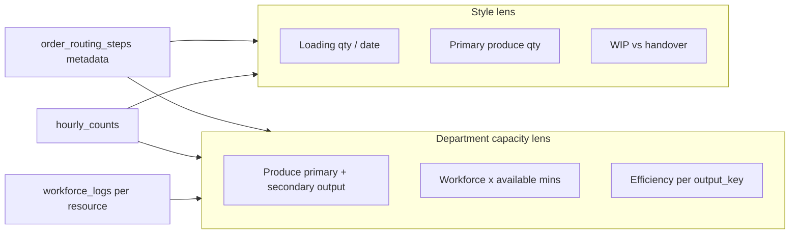
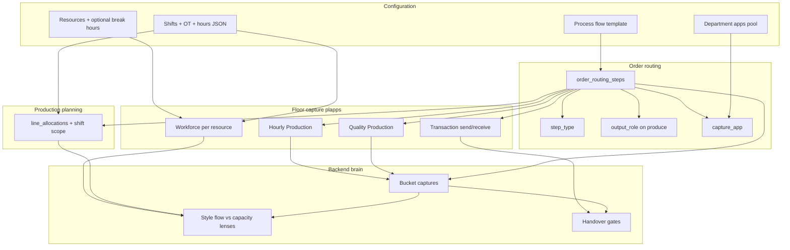

# Step types, capacity, shifts & floor capture — design reference

> **Purpose:** Explain how routing step semantics, department resources, shifts (including OT), and floor apps work together so **capacity**, **style flow output**, and **WIP** are measured correctly — without multiplying floor apps or breaking the Output XOR QC rule.

**Audience:** Product + engineering before schema/UI changes.

**Related code today:**
- Floor apps catalog: `lib/floorApps.ts`
- Process flow editor (per-step `capture_app`): `components/settings/ProcessFlowEditor.tsx`
- Planning rows: `pages/planning/types.ts`, `PlanningTable.tsx`
- Workforce log (per **resource** + shift): `plapps/app/floor/workforce/[resourceId]/log/page.tsx`
- Hourly / QC capture: `plapps/app/floor/hourly/*`, `plapps/app/floor/quality/*`
- Handover (send/receive): `plapps/app/floor/transaction/*` — all production departments
- Shift hour math: `lib/shiftSlots.ts`, `lib/shiftHours.ts`
- Floor audit: `plapps/FLOOR_APP_AUDIT.md`

---

## 1. The problem in one sentence

The same department can appear **more than once** on a route (Block Cut → Fixed Cut; Line Loading → Sewing Output). Those visits differ in **what they mean for the factory**:

| Visit | Workforce used? | Counts for style WIP / next dept? | Counts for dept capacity / efficiency? |
|-------|-----------------|-----------------------------------|----------------------------------------|
| Block Cut (produce) | Yes | No (prep) | Yes — block-cut produced + efficiency |
| Fixed Cut (produce) | Yes | **Yes** — feeds Sewing | Yes — fixed-cut produced + efficiency |
| Line Loading (loading) | No (mostly) | **Yes** — style started / WIP signal | **No** — excluded from capacity denominator |
| Sewing Output (produce) | Yes | **Yes** | Yes |

The **backend brain** must classify each routing step once, then every report (planning, dept KPI, style journey, gantt) reads the same flags.

---

## 2. Step types (simplified taxonomy)

Replace the current mixed set (`produce`, `inspect`, `move`, `delay`, `outsource`) with **four** routing step types:

| `step_type` | Meaning | Floor production apps | Handover send/receive |
|-------------|---------|----------------------|------------------------|
| **`loading`** | Input / line feed / WIP start. Pieces are **received** and acknowledged as started; little or no measurable output. | Optional **`hourly`** only (count “loaded” pieces, not SAM output) | Native — always available |
| **`produce`** | Real work — SAM, targets, defects possible. | **`hourly`** *or* **`qc_log`** (see §4) | Native |
| **`store`** | Buffer / rack / WIP hold. No production. Pieces may sit; only logistics. | **None** | Native |
| **`outsource`** | External leg. No in-house production. | **None** | Native (out-challan + return-challan) |

**Removed as step types:** `inspect`, `move`, `delay`.

- **Inspect** is not a separate step type. Quality work is selected via **`capture_app`** on a `produce` step (see §4).
- **Move** is unnecessary — handover already moves WIP between departments.
- **Delay** is renamed conceptually to **`store`** (goods stored, no production).

**Rule:** `store` and `outsource` never open Hourly or QC. Operators only use Transaction (send/receive). Audit remains **department-native** (optional AQL), not a step type.

---

## 3. `output_role` — only on `produce`

`output_role` answers: *“For this produce visit, what kind of output number is this?”*

| `output_role` | Applies to | Style flow / handover gate | Dept capacity metrics |
|---------------|------------|----------------------------|------------------------|
| **`primary`** | Default produce step that **feeds the next department** | **Yes** — this qty drives WIP completion for the route | Yes |
| **`secondary`** | Produce that uses workforce but is **not** the main flow output (e.g. Block Cut before Fixed Cut) | No for downstream gate; still visible on style journey | Yes — separate bucket (block-cut produced, block-cut efficiency) |
| *(null)* | `loading`, `store`, `outsource` | N/A | N/A |

**Validation rules (on save routing / apply template):**

1. Per department **per order route**, at most **one** `produce` + `primary` (the visit that gates handover to the next dept).
2. If the same department appears twice with both `produce`: typically first = `secondary`, last = `primary` (configurable, but this is the default for Cut and Sew patterns).
3. `loading` before `produce` in the same dept is allowed (Sewing pattern). Loading never gets `output_role`.
4. Two `produce` + `primary` in the same dept is an error (e.g. Block and Fixed both primary — pick one as primary).

**Suggested persisted columns on `order_routing_steps`:**

```text
step_type      text   -- loading | produce | store | outsource
output_role    text   -- primary | secondary | null
output_key     text   -- optional stable key: block_cut, fixed_cut, sewing_output, line_loading
capture_app    text   -- hourly | qc_log | transaction (meaning: no production app)
counts_for_flow boolean  -- derived: produce AND output_role = primary
counts_for_capacity boolean -- derived: produce (both roles) OR special-case loading=false
utilizes_workforce boolean -- derived: produce; loading=false; store/outsource=false
```

`output_key` lets reports say “Block Cut produced” vs “Fixed Cut produced” even when labels vary by factory.

---

## 4. Floor apps — keep it simple (SOTA mechanism)

### 4.1 What exists today (plapps)

| App ID | Floor route | What it captures |
|--------|-------------|------------------|
| `hourly` | `/floor/hourly` | Hourly **output** count by shift + hour slot + size |
| `qc_log` | `/floor/quality` | Piece-wise pass/fail/rework → output + **defects** |
| `transaction` | `/floor/transaction` | Handover send/receive (challan) |
| `workforce_log` | `/floor/workforce` | Headcount per **resource** + shift + date |
| `audit` | `/floor/audit` | Optional AQL batch (department capability, not per-step) |

Home deduplicates: if a user has hourly + qc_log + transaction, they see one **Production** tile. The app opened for a style is determined by the **selected operation’s `capture_app`**, not a fixed dept setting.

**Department `apps[]`** = capability pool (what the work center *can* run).  
**Step `capture_app`** = which production app runs for *this operation visit*.

### 4.2 Link step type → capture_app (no new apps)

| step_type | Allowed `capture_app` | Notes |
|-----------|----------------------|--------|
| `loading` | `hourly` or `transaction` | If `hourly`: capture mode = **loading count** (not SAM efficiency). If unset: infer start from first handover receive only. |
| `produce` | `hourly` **or** `qc_log` | Pick one in Process Flow / Order Routing editor. Both record production; only QC records defects. |
| `store`, `outsource` | `transaction` only | UI hides production apps for these steps. |

**You do not need a separate “inspect” step type or app.** Rename in UI if helpful:

- `hourly` → **Hourly Production** (bulk output)
- `qc_log` → **Quality Production** (piece output + defects)

The **Output XOR QC** rule stays at **department + order + active session** level: only one of hourly or qc session active at a time — already how the floor works.

### 4.3 What does NOT need `capture_app`

- **Send / receive** — every production department gets Transaction natively. `transaction_app` on routing (already implemented) marks which visit is the handover exit for consecutive same-dept steps.
- **Workforce** — logged per resource via Workforce Log, not per routing step.
- **Audit** — optional dept capability; does not block flow.

### 4.4 Capture payload (unchanged shape, richer routing metadata)

Every production capture already should include `operationId` → `order_routing_steps.id`. The RPC/brain uses that row’s `step_type`, `output_role`, `output_key` to bucket counts.

```text
hourly_upsert  → bucket by output_role / output_key / counts_for_*
inspection     → same bucketing + defect KPIs
handover_send  → gated on counts_for_flow completion at prior primary produce
```

No change to how operators pick shift + hour slot on the floor.

---

## 5. Capacity vs style output — worked examples

### 5.1 Cutting: Block + Fixed (both produce, different roles)

```text
Route:  … → Cutting [Block Cut, produce, secondary, block_cut, hourly]
            → Cutting [Fixed Cut, produce, primary, fixed_cut, hourly]
            → Sewing …
```

| Metric | Block Cut | Fixed Cut |
|--------|-----------|-----------|
| Style “Cutting complete” for handover to Sewing | Ignored | **Uses Fixed qty** |
| Dept capacity “Cutting produced today” | **Included** | **Included** |
| Efficiency (output vs SAM × workforce × mins) | **Block cut efficiency** | **Fixed cut efficiency** |
| Style journey line | “Block cut: 1,200” | “Fixed cut: 1,000” |

Both utilize workforce logged on cutting resources. Both earn available minutes. Both can miss target independently.

### 5.2 Sewing: Line loading + Output

```text
Route:  … → Sewing [Line Loading, loading, line_loading, hourly optional]
            → Sewing [Sewing Output, produce, primary, sewing_output, hourly]
            → …
```

| Metric | Line Loading | Sewing Output |
|--------|--------------|---------------|
| Style WIP “started” | **Yes** — first load date OR first load count | Output progress |
| Handover to next dept | No | **Yes** |
| Dept capacity / efficiency | **Excluded** from capacity denominator | **Included** |
| Workforce on resource | Not expected (0 or N/A) | From workforce_log |
| Available minutes | If style allocated on line, mins still accrue (see §5.3) | Full SAM math |

**Style started rule:** `style_started_at` = earliest of:

- first `loading` hourly capture for that operation, or
- first handover **receive** at that operation, or
- line allocation `start_date` on the loading operation (planning signal).

Even with **zero** sewing output, the style shows as **started** once loading is recorded.

### 5.3 Loading + efficiency / learning curve

When a style is allocated to a sewing line:

- **Available minutes** accrue each hour the allocation is active on that resource (from shift slots × workforce if logged).
- **Output** is zero until Sewing Output produces.
- **Efficiency** = output ÷ expected (SAM-based) → shows **0%** initially — this is correct (learning curve / setup).
- Loading qty may show on a **separate style KPI strip** (“Loaded: 500 on 12 Mar”) without polluting dept efficiency.



---

## 6. Shifts, OT, and planning targets

### 6.1 What you have today

- **`shifts`** table: factory-defined shifts (e.g. Day 05:00–13:00, Evening 13:00–22:00, OT).
- **`shifts.hours`**: JSON array of `{ start, end, type: active|break }` — used for report hour columns and productive minutes.
- **Workforce log**: `resource_id` + `shift_id` + `log_date` + headcount by category (`plapps` workforce flow).
- **`line_allocations`**: date range + daily_target + workforce — **no `shift_id` yet**; planning assumes one “regular” shift day (`lib/shiftHours.ts`).

### 6.2 What planning must answer

When a planner sets **daily target = 800** on Sewing Line 2 for 10–15 Mar, they mean:

- **Which shift?** Day only, Evening only, or both?
- **OT?** Is 800 for regular hours or does OT add on top?

### 6.3 Recommended planning model

**Option A — shift-scoped allocation rows (recommended)**

Extend `line_allocations` (or add child rows):

```text
shift_id     uuid  NULL = all regular shifts combined (legacy)
shift_scope  text  regular | ot | all
daily_target int   per shift scope
hourly_target computed from shift productive mins, not gross 8h
```

Planner UI:

1. Pick operation → resource → date range (unchanged).
2. **Shift column:** Day | Evening | OT | All day.
3. Daily target applies to **that shift’s productive minutes** only.

**Option B — single row, split targets in JSON**

`kpi_inputs: { "shift_targets": { "<shift_uuid>": 400, "<ot_uuid>": 200 } }` — flexible but harder in UI.

**OT handling:**

- OT is a separate `shifts` row (`type: Overtime`).
- Planning OT explicitly — never silently folded into regular target.
- Reports already separate DAY vs OT totals on the hourly style card (`plapps` StyleProgressCard).

**Gantt / timeline:**

- Show shift bands (background) on the departmental gantt.
- Bars sit on calendar dates; tooltip shows per-shift target when shift-scoped.

### 6.4 Breaks — per department **resource**, not shift group

Workforce is logged **per resource** (line, table, machine) — `assigned_resources` in Settings → Department resources.

Therefore **break overrides attach to the resource** (or a resource group within the dept), not to a factory-wide workforce group.

```text
shifts.hours              → factory default active/break timeline for shift "Day"
assigned_resources.hours  → optional override for this line (e.g. Line 1 lunch 13:00–14:00,
                            Line 2 lunch 14:00–15:00)
```

**Available minutes for efficiency (resource R, shift S, date D):**

```text
available_mins = headcount(R,S,D) × productive_mins(R,S)
productive_mins(R,S) = sum(active blocks in shift.hours)
                     − sum(break blocks in COALESCE(resource.hours, shift.hours))
```

Workforce categories (operator, helper, …) stay as **headcount breakdown** inside one resource log — they do not define separate break schedules unless you later split one physical line into sub-resources.

---

## 7. Reporting lenses (single source of truth)

Define views/RPCs that always join capture → `order_routing_steps`:

| View / metric | Filter |
|---------------|--------|
| **Style flow produced** | `step_type = produce` AND `output_role = primary` |
| **Style loading / started** | `step_type = loading` |
| **Dept total output** | `step_type = produce` (primary + secondary) |
| **Dept efficiency by activity** | group by `output_key` |
| **Capacity utilization** | `utilizes_workforce = true` |
| **Handover eligibility** | prior step `counts_for_flow` complete |

This avoids special-casing “Sewing” vs “Cutting” in report code.

---

## 8. Implementation phases

### Phase 1 — Schema + routing flags (no floor UI change)

1. Migrate `step_type` CHECK to `loading | produce | store | outsource`.
2. Add `output_role`, `output_key`, derived booleans on `order_routing_steps` (+ process flow template).
3. `save_order_routing` validates primary uniqueness per dept.
4. Backfill existing routes: all current `produce` → `primary`; split cut/sew templates manually.

### Phase 2 — Brain / reporting

1. KPI views bucket `hourly_counts` + `inspections` by routing metadata.
2. Style journey: show loading line + per-`output_key` produce lines.
3. Handover gate uses `counts_for_flow` only.

### Phase 3 — Planning

1. Add `shift_id` / `shift_scope` to line allocations.
2. Planning table: shift picker + OT row.
3. Recompute `hourly_target` from `shiftSlots.productiveMinsFromHours` for selected shift.

### Phase 4 — Settings + floor polish

1. Process Flow editor: step type + output role + capture_app rules (§4.2).
2. Optional: `assigned_resources.hours` break override editor.
3. Hourly capture on `loading` steps: label “Loaded qty” not “Output”; RPC tags `capture_kind = loading`.

---

## 9. FAQ

**Q: Why not make QC a step type?**  
A: QC and hourly both answer “how much production happened?” — defects are the only difference. One `produce` type + `capture_app` keeps the floor tile simple and preserves Output XOR QC.

**Q: Does loading use workforce?**  
A: Usually no. Capacity reports should not expect workforce on loading. If a factory logs helpers on loading, treat as optional — still exclude from SAM efficiency.

**Q: Can Block Cut and Fixed Cut both be primary?**  
A: Only if they feed **different** downstream branches (split route). For a linear flow, one primary.

**Q: Store vs outsource?**  
A: Both are non-producing for apps. Outsource adds two-leg handover semantics and vendor context; store is in-house buffer.

**Q: Rename apps?**  
A: Safe in UI labels only (`Hourly Production`, `Quality Production`). Keep DB IDs `hourly` and `qc_log`.

---

## 10. Summary diagram



---

*Last updated: planning discussion — step types, resource-level breaks, shift-scoped targets, capacity vs flow output.*
